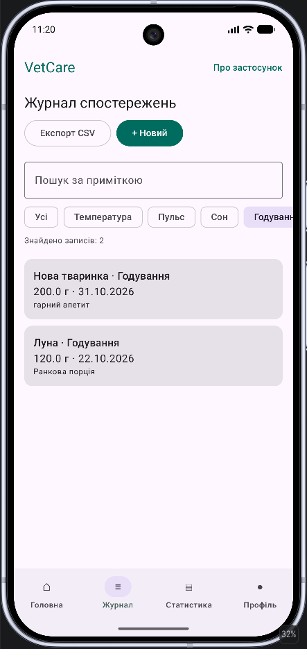
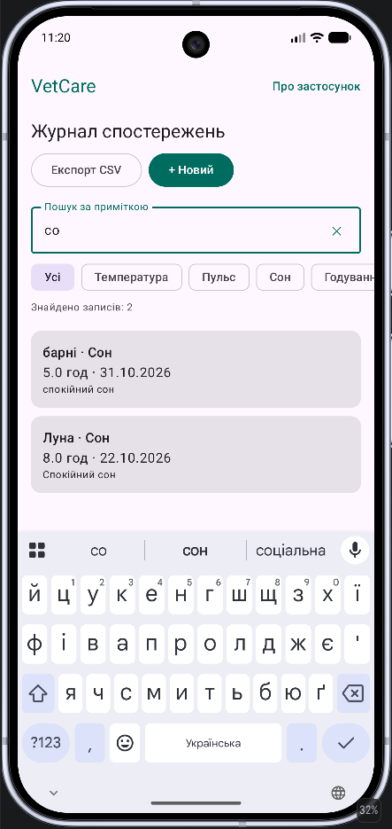
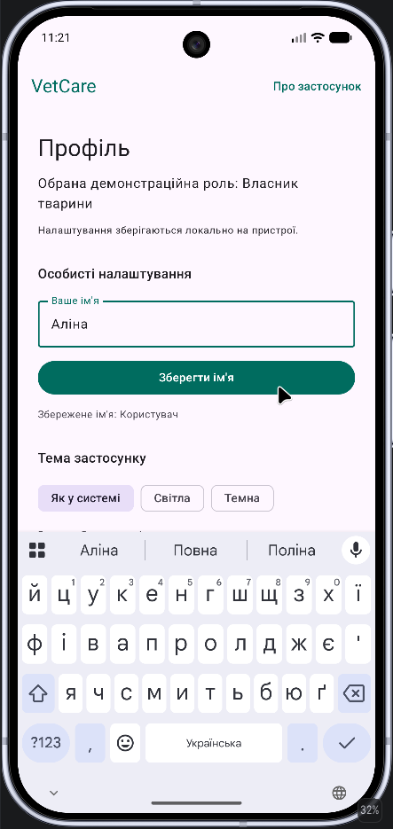
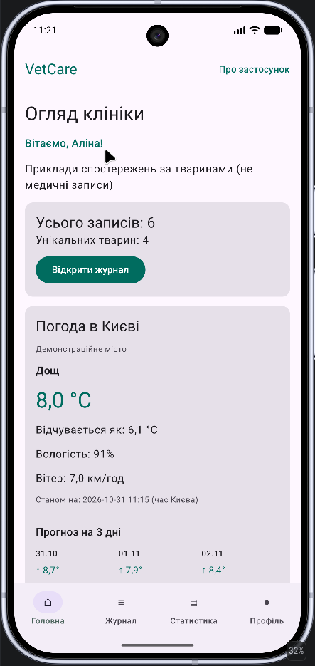
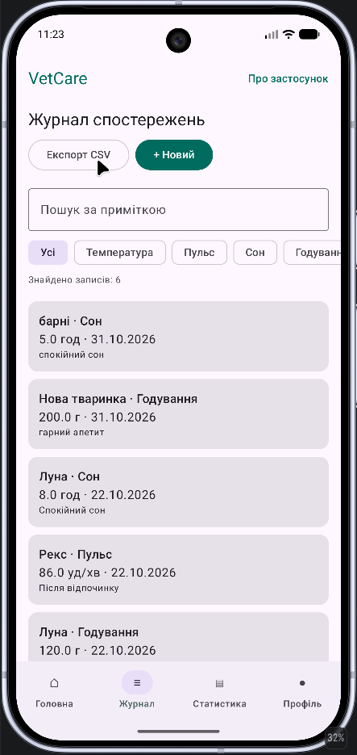
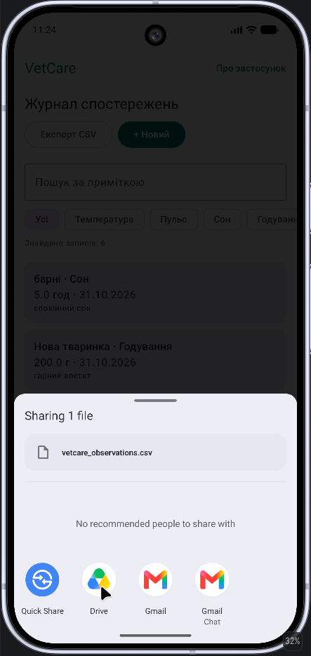
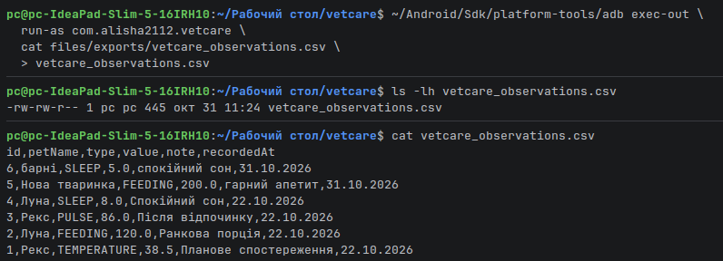
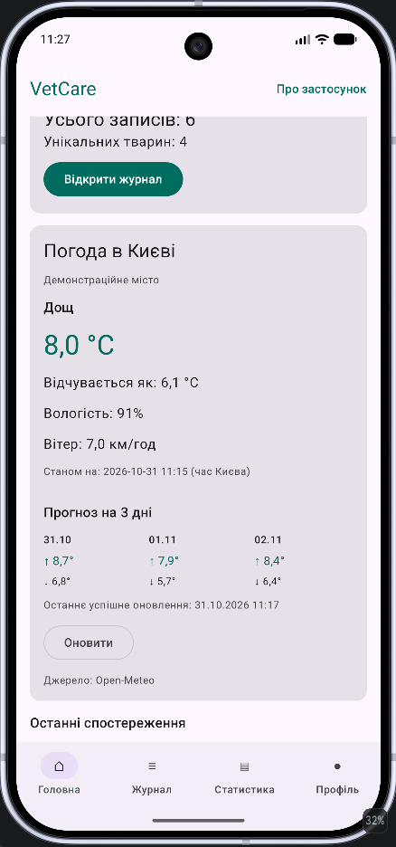
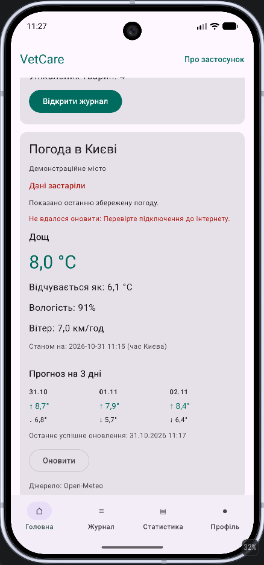

# VetCare

VetCare — навчальний мобільний застосунок для Android, призначений для ведення журналу спостережень за тваринами. У цьому README я документую виконання практичних завдань із дисципліни «Програмування мобільних платформ».

---

## Практичне завдання 3.6 — Робота з даними: локальне сховище та мережа

**Гілка:** `feature/task-3.6`  
**Розділ методичних вказівок:** 3. Робота з даними: локальне сховище та мережа.

### 1. Короткий опис реалізованого функціоналу

У застосунку VetCare я реалізувала локальне зберігання спостережень за тваринами за допомогою Room, фільтрацію записів за типом, пошук за приміткою та збереження налаштувань користувача через DataStore. Додатково реалізувала експорт записів журналу у CSV-файл із можливістю поширення через системне меню Android. Для роботи з мережею інтегрувала Open-Meteo через Retrofit: на головному екрані відображаються поточна погода в Києві, прогноз на три дні та останні збережені погодні дані з позначкою «Дані застаріли», якщо оновити їх через інтернет не вдалося.

### 2. Демонстрація роботи

Для перевірки реалізованих можливостей я запустила VetCare на емуляторі **Google Pixel 10 Pro**. Нижче наведено приклади роботи журналу спостережень, локальних налаштувань, експорту CSV та отримання погодних даних. Усі зображення розміщено в каталозі `reports/lab-03/screenshots/`.

#### 2.1. Локальне зберігання записів, фільтрація та пошук

Для зберігання спостережень за тваринами я використала **Room**. Кожен запис містить кличку тварини, тип показника, числове значення, дату та примітку. На рисунку 1 показано журнал із шістьма збереженими записами, які відображаються після відкриття відповідного екрана.

**Рисунок 1 — Журнал спостережень із записами з локальної бази даних.**

Для швидкого перегляду потрібної інформації я додала фільтрацію за типом спостереження. Після вибору категорії **«Годування»** журнал відображає лише два записи цього типу, що продемонстровано на рисунку 2.

**Рисунок 2 — Результат фільтрації журналу за типом «Годування».**

Також я реалізувала пошук за приміткою. На рисунку 3 у поле пошуку введено фрагмент **«со»**, після чого відображаються два записи, примітки яких містять цей текст. Це дає змогу знаходити спостереження без перегляду всього журналу.

**Рисунок 3 — Пошук за фрагментом тексту примітки.**

#### 2.2. Збереження налаштувань через DataStore

Для зберігання невеликих налаштувань я використала **DataStore Preferences**. На екрані профілю можна ввести ім'я користувача та вибрати тему застосунку: системну, світлу або темну. На рисунку 4 показано введення імені **«Аліна»** в налаштуваннях профілю.

**Рисунок 4 — Екран профілю з полем імені та вибором теми.**

Після збереження імені воно використовується на головному екрані: з'являється привітання **«Вітаємо, Аліна!»**. Цей результат показано на рисунку 5.

**Рисунок 5 — Головний екран із персоналізованим привітанням.**

#### 2.3. Експорт записів у CSV-файл

У журналі я реалізувала кнопку **«Експорт CSV»**, за допомогою якої записи можна зберегти у файлі `vetcare_observations.csv`. На рисунку 6 показано місце запуску експорту.

**Рисунок 6 — Кнопка «Експорт CSV» у журналі спостережень.**

Після натискання кнопки застосунок створює CSV-файл і відкриває системне вікно поширення Android. Для передавання файлу іншому застосунку використано `Intent.ACTION_SEND` і `FileProvider`. На рисунку 7 видно створений файл `vetcare_observations.csv` у системному меню.

**Рисунок 7 — Системне вікно Android для поширення CSV-файлу.**

Щоб перевірити не лише відкриття системного меню, а й **вміст експортованого файлу**, я скопіювала CSV із внутрішнього сховища застосунку за допомогою ADB і переглянула його в терміналі Linux Mint. У файлі присутні заголовки `id`, `petName`, `type`, `value`, `note`, `recordedAt` та всі шість записів журналу. Це підтверджує, що експорт дійсно формує файл з даними, а не просто відкриває вікно поширення.

**Рисунок 8 — Перевірка вмісту експортованого CSV-файлу в терміналі.**

#### 2.4. Отримання погодних даних і прогноз на три дні

Для роботи з мережею я підключила **REST API Open-Meteo** за допомогою **Retrofit**. На головному екрані VetCare відображаються погодні умови для демонстраційного міста Київ: температура, відчутна температура, вологість, вітер та прогноз максимальної й мінімальної температури на три дні. На рисунку 9 показано успішне отримання погодних даних і прогноз на **31.10, 01.11 та 02.11**.

**Рисунок 9 — Поточна погода в Києві та прогноз на три дні.**

#### 2.5. Збереження погоди та робота без інтернету

Останню успішно отриману відповідь Open-Meteo я зберігаю в **DataStore**. Якщо мережевий запит не вдається виконати, застосунок продовжує відображати останні доступні дані замість порожнього екрана. Водночас користувач бачить повідомлення **«Дані застаріли»** та пояснення, що оновити погоду не вдалося.

На рисунку 10 показано саме такий сценарій: поточні дані й триденний прогноз залишаються доступними, а інтерфейс попереджає про відсутність свіжого оновлення.

**Рисунок 10 — Відображення збережених погодних даних під час помилки мережевого запиту.**

### 3. Відповіді на контрольні питання розділу 3

**1. Коли використовувати DataStore, а коли базу даних?**

DataStore доцільно використовувати для зберігання невеликих налаштувань, наприклад імені користувача, вибраної теми або кешованої відповіді API. Базу даних Room варто застосовувати для структурованих записів, з якими потрібно виконувати операції додавання, редагування, видалення, сортування та пошуку. У VetCare я використала Room для журналу спостережень, а DataStore — для налаштувань і погодного кешу.

**2. Яке призначення `@Entity`, `@Dao`, `@Database`?**

`@Entity` позначає клас, який представляє таблицю бази даних. `@Dao` визначає методи доступу до даних і SQL-запити, а `@Database` описує конфігурацію бази даних, її сутності та версію і надає доступ до DAO.

**3. Чому DAO-запит повертає `Flow`?**

`Flow` дозволяє асинхронно спостерігати за змінами в базі даних. Якщо запис додати, змінити або видалити, Room може повторно виконати запит і передати новий результат, завдяки чому список у журналі оновлюється без ручного перезавантаження.

**4. Що таке міграція бази даних?**

Міграція — це керований перехід від однієї версії схеми бази даних до іншої. Вона потрібна, наприклад, під час додавання нових таблиць або полів, щоб оновити структуру бази й за можливості зберегти вже наявні дані користувача.

**5. Навіщо окремі класи `RecordEntity` і `HealthRecord`?**

`RecordEntity` відповідає за представлення запису у структурі Room, а `HealthRecord` — за дані, з якими працює логіка застосунку. Таке розділення зменшує залежність інтерфейсу та бізнес-логіки від структури бази даних. У VetCare аналогічну роль виконують `ObservationEntity` і модель `VetObservation`.

**6. З яких частин складається HTTP-запит?**

HTTP-запит містить метод (`GET`, `POST` тощо), адресу ресурсу (URL і шлях), заголовки та, за потреби, тіло запиту. Параметри запиту також можуть передаватися в URL, наприклад координати й перелік погодних показників для Open-Meteo.

**7. Чим відрізняються коди `4xx` і `5xx`?**

Коди `4xx` означають помилки на стороні клієнтського запиту, наприклад `400 Bad Request` або `404 Not Found`. Коди `5xx` повідомляють про помилку на стороні сервера, наприклад `500 Internal Server Error` або `503 Service Unavailable`.

**8. Навіщо окремі DTO і доменна модель?**

DTO описує формат даних, які надходять із сервера або передаються йому, а доменна модель представляє дані у зручному для застосунку вигляді. Так можна незалежно змінювати спосіб роботи з API й логіку відображення інформації, не прив'язуючи інтерфейс безпосередньо до структури JSON-відповіді.

**9. Чому стан запиту описують `sealed interface`?**

`sealed interface` дозволяє явно визначити всі можливі стани запиту, наприклад `Loading`, `Success` та `Error`. Це спрощує обробку результатів у `ViewModel` і побудову інтерфейсу, а також допомагає перевірити всі варіанти стану під час використання `when`.

**10. Чому не можна виконувати мережеві запити в головному потоці?**

Головний потік Android відповідає за обробку взаємодій користувача та оновлення інтерфейсу. Якщо виконувати в ньому тривалий мережевий запит, застосунок може перестати реагувати на дії користувача й отримати помилку ANR. Тому мережеві операції потрібно виконувати асинхронно, наприклад через `suspend`-функції Retrofit і корутини.

### 4. Висновок

Під час виконання практичного завдання я навчилася працювати з локальними даними за допомогою Room і DataStore, виконувати SQL-фільтрацію та пошук, експортувати записи у CSV і отримувати інформацію із зовнішнього REST API. Також реалізувала збереження погодних даних для використання без інтернету, завдяки чому VetCare може відображати останній доступний прогноз навіть у разі помилки мережевого запиту.
