# VetCare

VetCare — навчальний мобільний застосунок для Android, призначений для ведення журналу спостережень за тваринами. У цьому README я документую виконання практичних завдань із дисципліни «Програмування мобільних платформ».

---

## Практичне завдання 3.6 — Робота з даними: локальне сховище та мережа

**Гілка:** `feature/task-3.6`  
**Розділ методичних вказівок:** 3. Робота з даними: локальне сховище та мережа.

### 1. Короткий опис реалізованого функціоналу

У застосунку VetCare я реалізувала локальне зберігання спостережень за тваринами за допомогою Room, фільтрацію записів за типом, пошук за приміткою та збереження налаштувань користувача через DataStore. Додатково реалізувала експорт записів журналу у CSV-файл із можливістю поширення через системне меню Android. Для роботи з мережею інтегрувала Open-Meteo через Retrofit: на головному екрані відображаються поточна погода в Києві, прогноз на три дні та останні збережені погодні дані з позначкою «Дані застаріли», якщо оновити їх через інтернет не вдалося.

### 2. Демонстрація роботи

Для перевірки реалізованих можливостей я запустила VetCare на емуляторі **Google Pixel 10 Pro**. Нижче наведено приклади роботи журналу спостережень, локальних налаштувань, експорту CSV та отримання погодних даних. Усі зображення розміщено в каталозі `reports/lab-03/screenshots/`.

#### 2.1. Локальне зберігання записів, фільтрація та пошук

Для зберігання спостережень за тваринами я використала **Room**. Кожен запис містить кличку тварини, тип показника, числове значення, дату та примітку. На рисунку 1 показано журнал із шістьма збереженими записами, які відображаються після відкриття відповідного екрана.

**Рисунок 1 — Журнал спостережень із записами з локальної бази даних.**

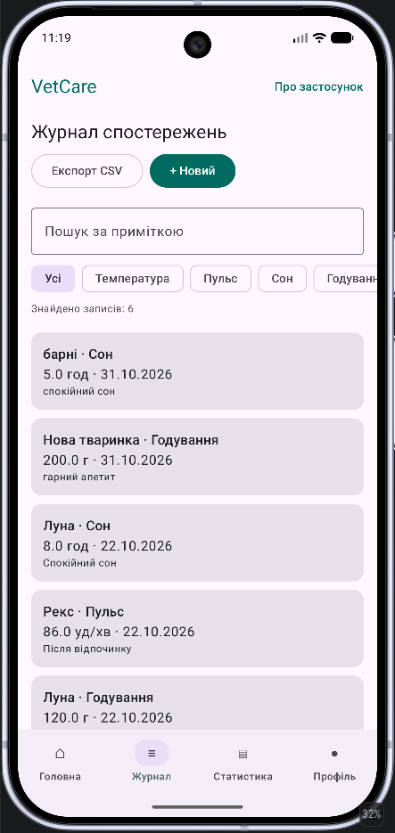

Для швидкого перегляду потрібної інформації я додала фільтрацію за типом спостереження. Після вибору категорії **«Годування»** журнал відображає лише два записи цього типу, що продемонстровано на рисунку 2.

**Рисунок 2 — Результат фільтрації журналу за типом «Годування».**

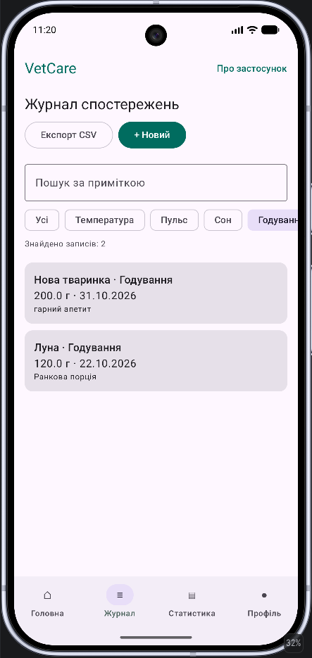

Також я реалізувала пошук за приміткою. На рисунку 3 у поле пошуку введено фрагмент **«со»**, після чого відображаються два записи, примітки яких містять цей текст. Це дає змогу знаходити спостереження без перегляду всього журналу.

**Рисунок 3 — Пошук за фрагментом тексту примітки.**

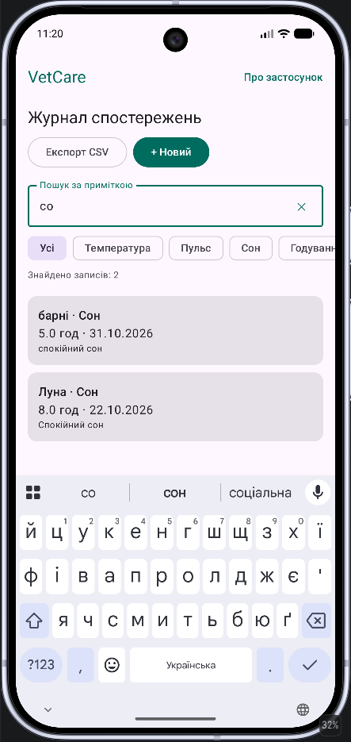

#### 2.2. Збереження налаштувань через DataStore

Для зберігання невеликих налаштувань я використала **DataStore Preferences**. На екрані профілю можна ввести ім'я користувача та вибрати тему застосунку: системну, світлу або темну. На рисунку 4 показано введення імені **«Аліна»** в налаштуваннях профілю.

**Рисунок 4 — Екран профілю з полем імені та вибором теми.**

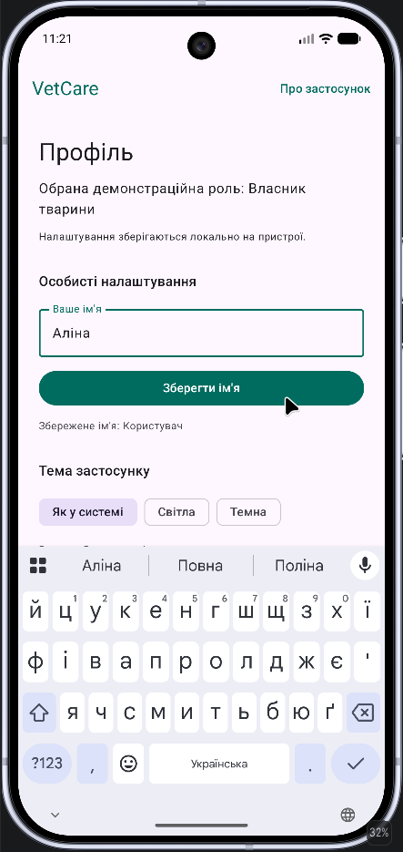

Після збереження імені воно використовується на головному екрані: з'являється привітання **«Вітаємо, Аліна!»**. Цей результат показано на рисунку 5.

**Рисунок 5 — Головний екран із персоналізованим привітанням.**

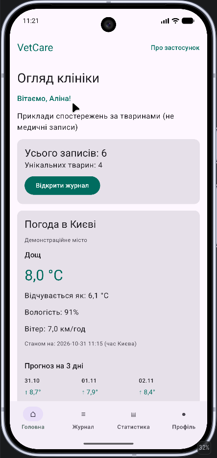

#### 2.3. Експорт записів у CSV-файл

У журналі я реалізувала кнопку **«Експорт CSV»**, за допомогою якої записи можна зберегти у файлі `vetcare_observations.csv`. На рисунку 6 показано місце запуску експорту.

**Рисунок 6 — Кнопка «Експорт CSV» у журналі спостережень.**

Після натискання кнопки застосунок створює CSV-файл і відкриває системне вікно поширення Android. Для передавання файлу іншому застосунку використано `Intent.ACTION_SEND` і `FileProvider`. На рисунку 7 видно створений файл `vetcare_observations.csv` у системному меню.

**Рисунок 7 — Системне вікно Android для поширення CSV-файлу.**

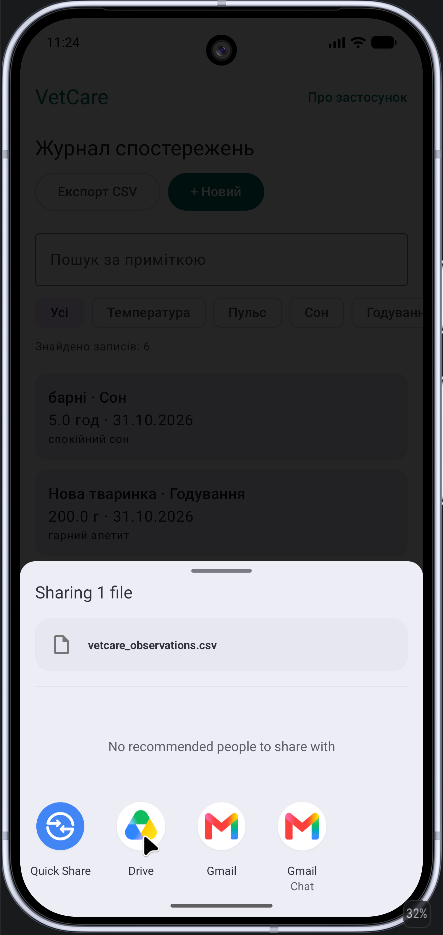

Щоб перевірити не лише відкриття системного меню, а й **вміст експортованого файлу**, я скопіювала CSV із внутрішнього сховища застосунку за допомогою ADB і переглянула його в терміналі Linux Mint. У файлі присутні заголовки `id`, `petName`, `type`, `value`, `note`, `recordedAt` та всі шість записів журналу. Це підтверджує, що експорт дійсно формує файл з даними, а не просто відкриває вікно поширення.

**Рисунок 8 — Перевірка вмісту експортованого CSV-файлу в терміналі.**

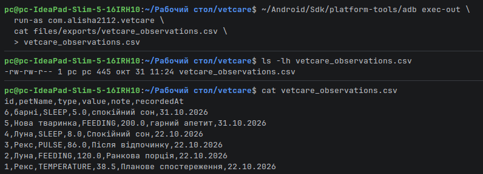

#### 2.4. Отримання погодних даних і прогноз на три дні

Для роботи з мережею я підключила **REST API Open-Meteo** за допомогою **Retrofit**. На головному екрані VetCare відображаються погодні умови для демонстраційного міста Київ: температура, відчутна температура, вологість, вітер та прогноз максимальної й мінімальної температури на три дні. На рисунку 9 показано успішне отримання погодних даних і прогноз на **31.10, 01.11 та 02.11**.

**Рисунок 9 — Поточна погода в Києві та прогноз на три дні.**

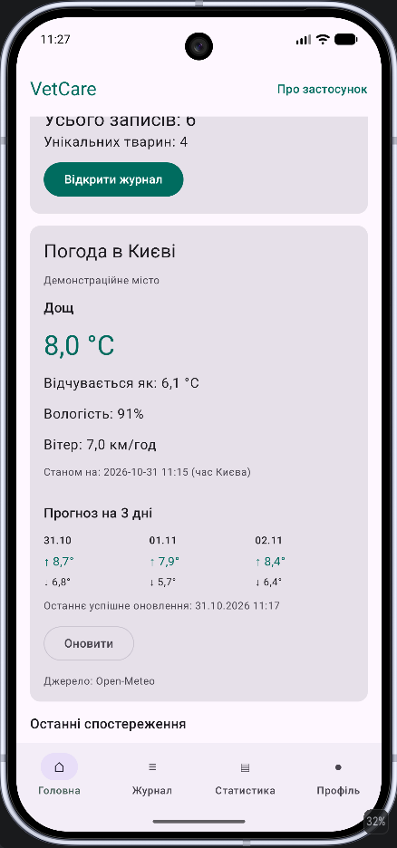

#### 2.5. Збереження погоди та робота без інтернету

Останню успішно отриману відповідь Open-Meteo я зберігаю в **DataStore**. Якщо мережевий запит не вдається виконати, застосунок продовжує відображати останні доступні дані замість порожнього екрана. Водночас користувач бачить повідомлення **«Дані застаріли»** та пояснення, що оновити погоду не вдалося.

На рисунку 10 показано саме такий сценарій: поточні дані й триденний прогноз залишаються доступними, а інтерфейс попереджає про відсутність свіжого оновлення.

**Рисунок 10 — Відображення збережених погодних даних під час помилки мережевого запиту.**

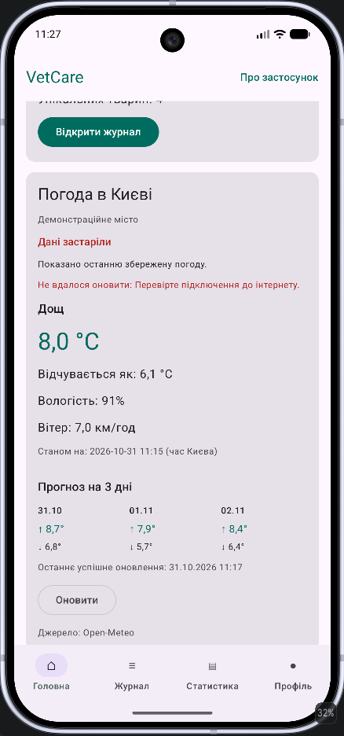

### 3. Відповіді на контрольні питання розділу 3

**1. Коли використовувати DataStore, а коли базу даних?**

DataStore доцільно використовувати для зберігання невеликих налаштувань, наприклад імені користувача, вибраної теми або кешованої відповіді API. Базу даних Room варто застосовувати для структурованих записів, з якими потрібно виконувати операції додавання, редагування, видалення, сортування та пошуку. У VetCare я використала Room для журналу спостережень, а DataStore — для налаштувань і погодного кешу.

**2. Яке призначення `@Entity`, `@Dao`, `@Database`?**

`@Entity` позначає клас, який представляє таблицю бази даних. `@Dao` визначає методи доступу до даних і SQL-запити, а `@Database` описує конфігурацію бази даних, її сутності та версію і надає доступ до DAO.

**3. Чому DAO-запит повертає `Flow`?**

`Flow` дозволяє асинхронно спостерігати за змінами в базі даних. Якщо запис додати, змінити або видалити, Room може повторно виконати запит і передати новий результат, завдяки чому список у журналі оновлюється без ручного перезавантаження.

**4. Що таке міграція бази даних?**

Міграція — це керований перехід від однієї версії схеми бази даних до іншої. Вона потрібна, наприклад, під час додавання нових таблиць або полів, щоб оновити структуру бази й за можливості зберегти вже наявні дані користувача.

**5. Навіщо окремі класи `RecordEntity` і `HealthRecord`?**

`RecordEntity` відповідає за представлення запису у структурі Room, а `HealthRecord` — за дані, з якими працює логіка застосунку. Таке розділення зменшує залежність інтерфейсу та бізнес-логіки від структури бази даних. У VetCare аналогічну роль виконують `ObservationEntity` і модель `VetObservation`.

**6. З яких частин складається HTTP-запит?**

HTTP-запит містить метод (`GET`, `POST` тощо), адресу ресурсу (URL і шлях), заголовки та, за потреби, тіло запиту. Параметри запиту також можуть передаватися в URL, наприклад координати й перелік погодних показників для Open-Meteo.

**7. Чим відрізняються коди `4xx` і `5xx`?**

Коди `4xx` означають помилки на стороні клієнтського запиту, наприклад `400 Bad Request` або `404 Not Found`. Коди `5xx` повідомляють про помилку на стороні сервера, наприклад `500 Internal Server Error` або `503 Service Unavailable`.

**8. Навіщо окремі DTO і доменна модель?**

DTO описує формат даних, які надходять із сервера або передаються йому, а доменна модель представляє дані у зручному для застосунку вигляді. Так можна незалежно змінювати спосіб роботи з API й логіку відображення інформації, не прив'язуючи інтерфейс безпосередньо до структури JSON-відповіді.

**9. Чому стан запиту описують `sealed interface`?**

`sealed interface` дозволяє явно визначити всі можливі стани запиту, наприклад `Loading`, `Success` та `Error`. Це спрощує обробку результатів у `ViewModel` і побудову інтерфейсу, а також допомагає перевірити всі варіанти стану під час використання `when`.

**10. Чому не можна виконувати мережеві запити в головному потоці?**

Головний потік Android відповідає за обробку взаємодій користувача та оновлення інтерфейсу. Якщо виконувати в ньому тривалий мережевий запит, застосунок може перестати реагувати на дії користувача й отримати помилку ANR. Тому мережеві операції потрібно виконувати асинхронно, наприклад через `suspend`-функції Retrofit і корутини.

### 4. Висновок

Під час виконання практичного завдання я навчилася працювати з локальними даними за допомогою Room і DataStore, виконувати SQL-фільтрацію та пошук, експортувати записи у CSV і отримувати інформацію із зовнішнього REST API. Також реалізувала збереження погодних даних для використання без інтернету, завдяки чому VetCare може відображати останній доступний прогноз навіть у разі помилки мережевого запиту.

---

## Практичне завдання 4.8 — Апаратні можливості пристрою

**Гілка:** `feature/task-4.8`

**Розділ методичних вказівок:** 4. Апаратні можливості пристрою.

### 1. Короткий опис реалізованого функціоналу

У застосунку VetCare я реалізувала роботу з апаратними можливостями Android: runtime-дозволи, пошук і підключення BLE-датчиків із читанням рівня заряду (Battery Service `0x180F`, характеристика `0x2A19`) та пульсу, визначення відстані від першої GPS-точки, маршрут дня та інтерактивну карту спостережень із лінією маршруту і його загальною довжиною. Також я додала прикріплення фотографій із камери або галереї до записів журналу, крокомір на основі `TYPE_STEP_COUNTER` зі збереженням результату в журналі та, як додаткову можливість, бульбашковий рівень на основі акселерометра.

### 2. Демонстрація роботи

Функціонал я перевіряла на емуляторі **Google Pixel 10 Pro (Android 17, API 37)**. Для імітації зміни місцезнаходження та показників акселерометра я використовувала засоби Android Emulator і ADB. Усі зображення розміщено в каталозі `reports/lab-04/screenshots/`.

#### 2.1. Головний екран та Android-дозволи

На головному екрані я додала блок **«Апаратні можливості»**, з якого можна перейти до перевірки геолокації, Bluetooth LE, крокоміра та бульбашкового рівня (рисунок 1).

**Рисунок 1 — Головний екран VetCare із блоком апаратних можливостей.**

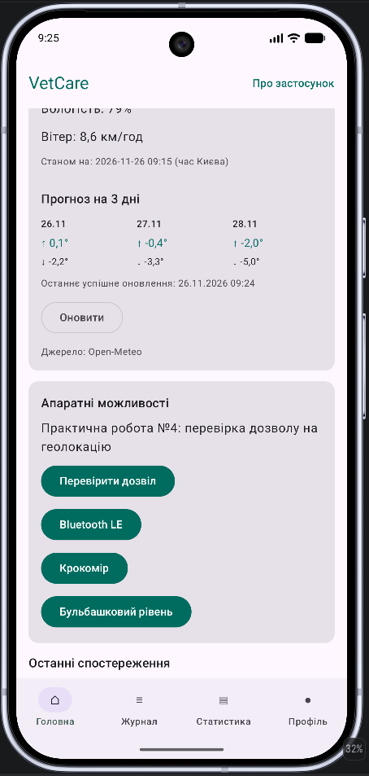

Усі потрібні дозволи я задекларувала в `AndroidManifest.xml`, а небезпечні запитую під час роботи застосунку через Activity Result API. Набір дозволів залежить від версії Android: для BLE на Android 12+ запитуються `BLUETOOTH_SCAN` (з прапорцем `neverForLocation`) і `BLUETOOTH_CONNECT`, а на Android 11 і старіших — `ACCESS_FINE_LOCATION` (старі `BLUETOOTH` і `BLUETOOTH_ADMIN` обмежено `maxSdkVersion="30"`). Апаратні можливості `bluetooth_le`, `sensor.stepcounter` і `sensor.accelerometer` позначено як `android:required="false"`, тому застосунок встановлюється й на пристрої без них. Для повторного використання я створила спільний компонент `rememberPermissionsState` і картку `PermissionCard`. На рисунку 2 показано системний запит дозволу на пошук і підключення до Bluetooth-пристроїв.

**Рисунок 2 — Системний запит дозволу на пошук і підключення до найближчих пристроїв.**

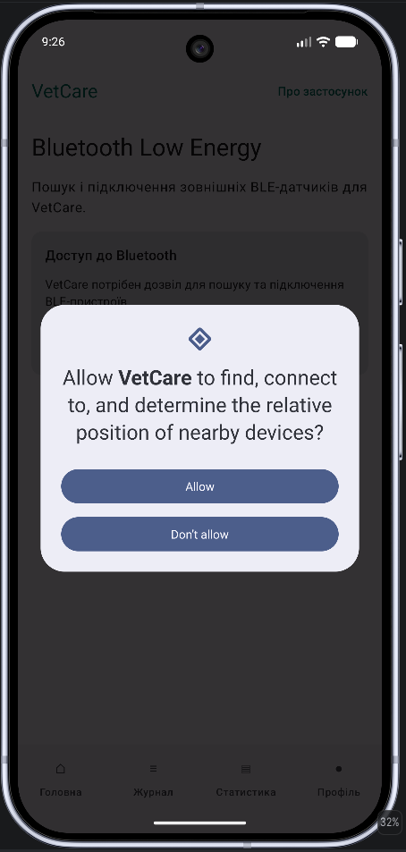

Якщо користувач відмовляє, застосунок не завершується з помилкою, а пояснює ситуацію й пропонує повторити запит або відкрити системні налаштування застосунку. Після повернення з налаштувань стан дозволу перевіряється повторно (рисунок 3).

**Рисунок 3 — Обробка відмови в наданні дозволу.**

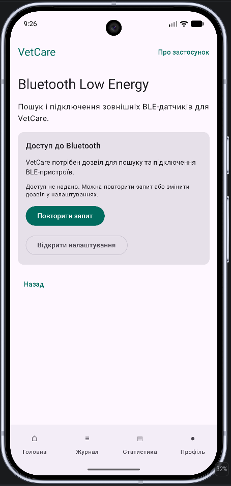

#### 2.2. Bluetooth Low Energy

Роботу з BLE я розділила на кілька класів. `BleManager` виконує сканування в режимі `SCAN_MODE_LOW_LATENCY` і повертає знайдені пристрої через `Flow`. `BleViewModel` прибирає повтори за MAC-адресою, сортує пристрої за RSSI, обмежує пошук 10 секундами та зупиняє сканування і GATT-підключення під час виходу з екрана. `BleGattClient` підключається до пристрою, виконує пошук сервісів, читає рівень заряду з **Battery Service `0x180F`** (характеристика **Battery Level `0x2A19`**) і підписується на **Heart Rate Measurement `0x2A37`**, записуючи дескриптор CCCD `0x2902`. `BleDataParser` декодує байти пульсу (8- або 16-бітний формат залежно від прапорця) і рівня заряду (допустимий діапазон 0–100 %). `BlePulseRecorder` зберігає отримане значення пульсу в журнал як запис типу **«Пульс»** і не дозволяє повторно зберегти те саме вимірювання.

На рисунку 4 показано BLE-екран після надання дозволу, на рисунках 5 і 6 — запуск і процес пошуку, а на рисунку 7 — завершення пошуку.

**Рисунок 4 — BLE-екран після надання дозволу.**

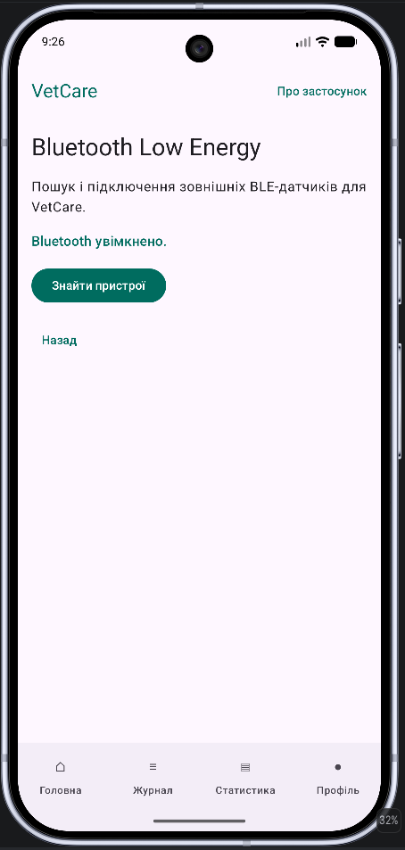

**Рисунок 5 — Запуск пошуку BLE-пристроїв.**

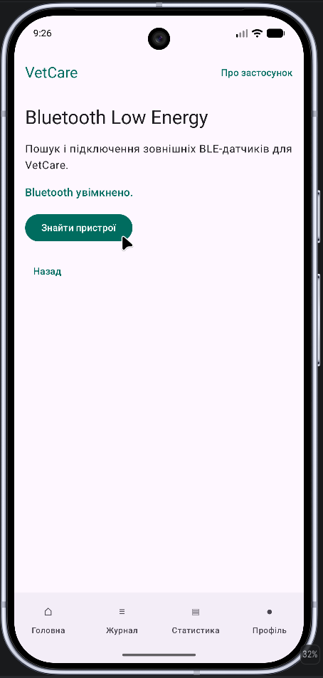

**Рисунок 6 — Активне сканування BLE-пристроїв.**

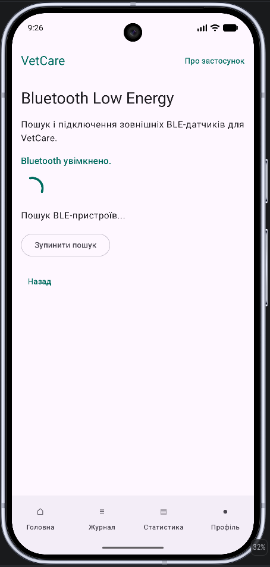

**Рисунок 7 — Завершення сканування без знайдених пристроїв.**

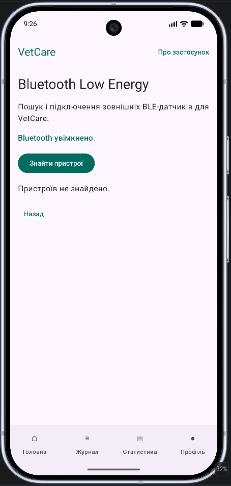

> **Пояснення щодо обмеження тестування BLE.** Під час виконання роботи в мене не було сумісної BLE-периферії (датчика пульсу або пристрою з Battery Service), а емулятор не надає реальних BLE-пристроїв. Тому повноцінно перевірити реальне GATT-підключення, читання рівня заряду та отримання пульсу не вдалося. Дозволи, запуск і автоматичне завершення сканування я перевірила на емуляторі, а парсинг BLE-даних і логіку збереження пульсу в журнал — модульними тестами (`BleDataParserTest`, `BlePulseRecorderTest`).

#### 2.3. Геолокація та маршрут дня

Для визначення координат я використала `LocationManager` через власний клас `LocationReader`. Він перевіряє дозволи `ACCESS_FINE_LOCATION`/`ACCESS_COARSE_LOCATION` та ввімкнення геолокації, обирає доступного провайдера (GPS, мережевий або Fused) і отримує одноразові координати через `LocationManagerCompat.getCurrentLocation()` із `CancellationSignal`, який скасовується при виході з екрана. На рисунку 8 показано екран геолокації до надання дозволу, на рисунку 9 — готовність зафіксувати початкову точку, а на рисунку 10 — процес отримання координат.

**Рисунок 8 — Екран геолокації до надання дозволу.**

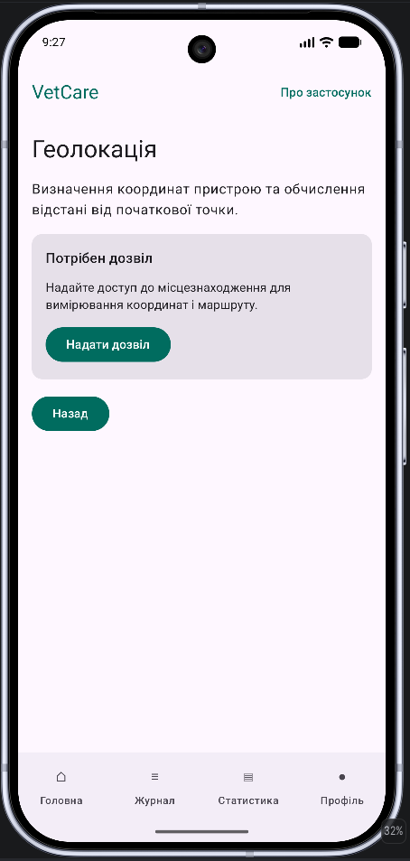

**Рисунок 9 — Дозвіл надано, можна зафіксувати початкову точку.**

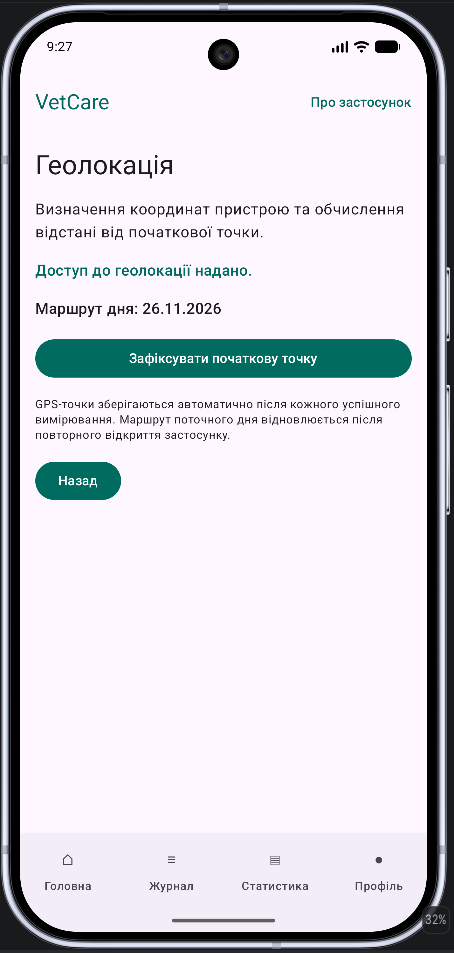

**Рисунок 10 — Отримання координат пристрою.**

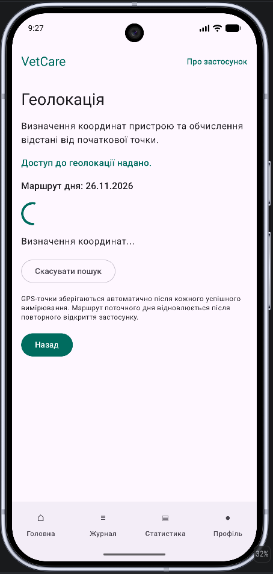

Перше успішне вимірювання стає початковою точкою. На рисунку 11 показано її координати, точність і нульову відстань від початку, а на рисунку 12 — цю точку на інтерактивній карті.

**Рисунок 11 — Початкова точка, точність вимірювання та нульова відстань від початку.**

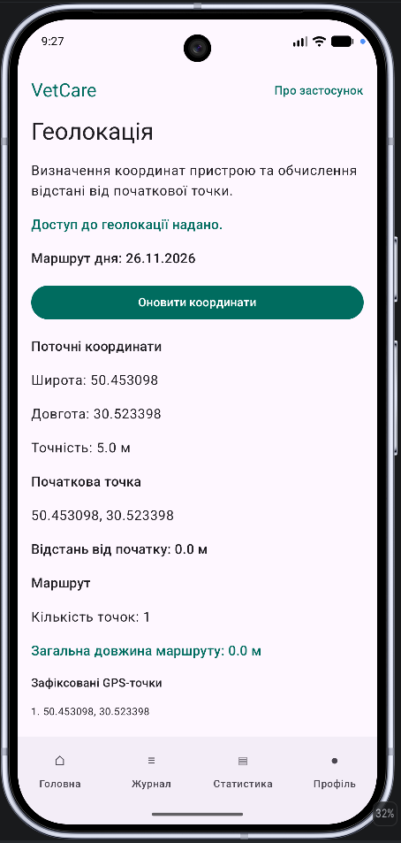

**Рисунок 12 — Початкова точка на інтерактивній карті.**

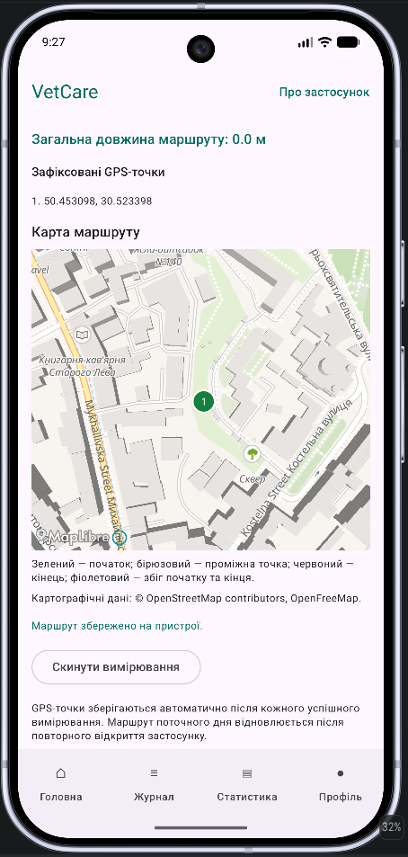

Для демонстрації переміщення я змінювала місцезнаходження емулятора засобами емуляції GPS. Після кожного повторного вимірювання (рисунок 13) відстань від першої точки обчислюється через `Location.distanceBetween()`. Усі точки поточного дня зберігаються в **DataStore** (`DailyRouteStore`), тому маршрут відновлюється після перезапуску застосунку. Щоб GPS-шум не створював зайвих точок, нова точка додається лише тоді, коли вона віддалена від попередньої щонайменше на 5 м або на величину похибки вимірювання. Загальну довжину маршруту я обчислюю як суму відстаней між сусідніми точками у функції `routeLengthMeters`.

**Рисунок 13 — Повторне визначення поточної позиції.**

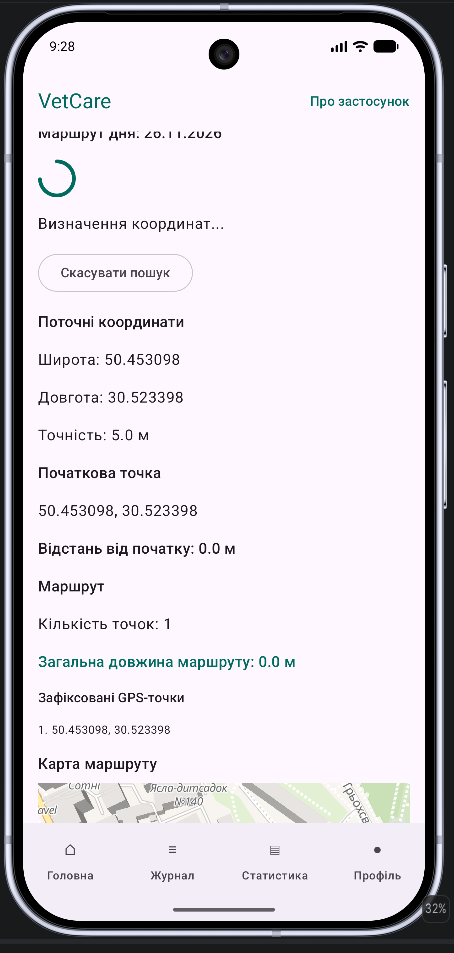

На рисунку 14 показано маршрут дня з **двох GPS-точок**: маркери початку й кінця з'єднані лінією, а загальна довжина маршруту становить **233,5 м**.

**Рисунок 14 — Маршрут дня з двох точок, лінія маршруту та його загальна довжина.**

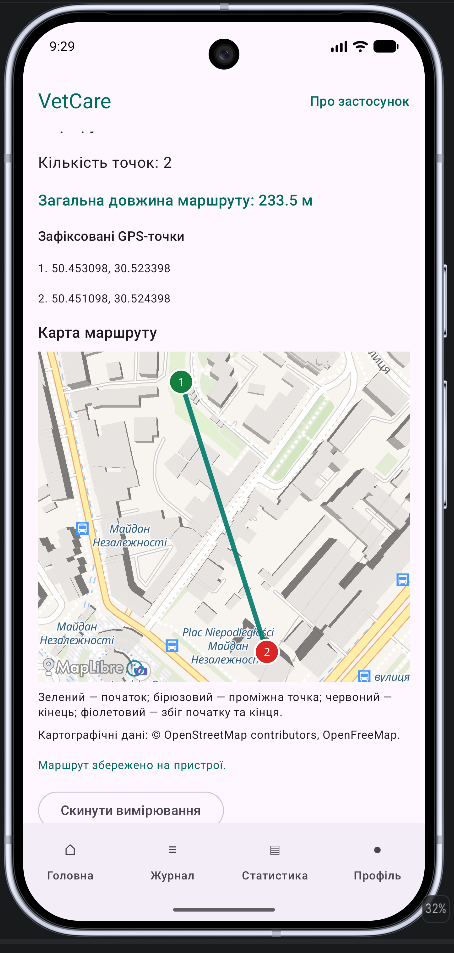

#### 2.4. Прикріплення GPS-координат до спостережень

Геолокація для запису є необов'язковою: координати можна прикріпити безпосередньо у формі створення спостереження, оновити або прибрати. Для цього я додала до моделі `VetObservation` і Room-сутності `ObservationEntity` nullable-поля `latitude` та `longitude`, а структуру бази оновила міграцією **Room 1 → 2** (`ALTER TABLE ... ADD COLUMN`), яка зберігає наявні записи. Якщо дозволу ще немає, натискання кнопки спочатку відкриває системний запит, а після його надання координати отримуються автоматично. На рисунку 15 показано створення спостереження для тварини **Барні** з температурою **38 °C**, на рисунку 16 — отримання координат, а на рисунку 17 — успішно прикріплені координати.

**Рисунок 15 — Створення спостереження для тварини Барні.**

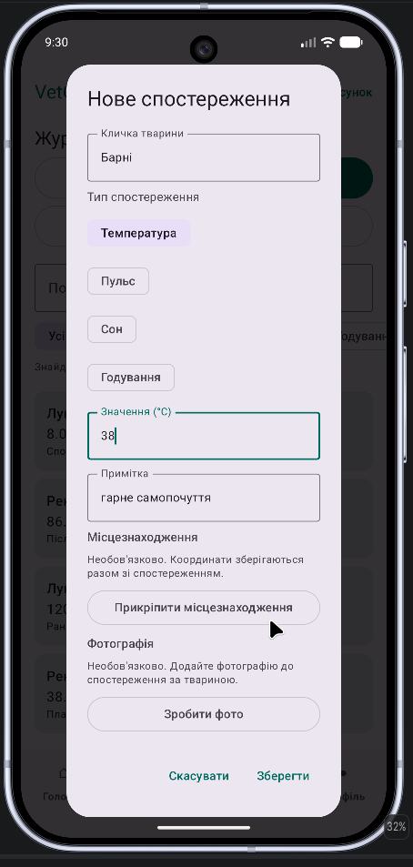

**Рисунок 16 — Отримання координат у формі спостереження.**

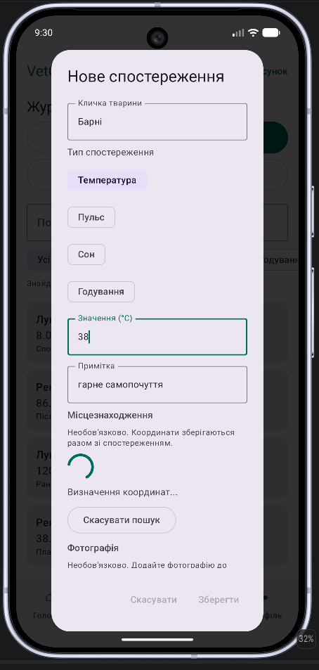

**Рисунок 17 — Успішно прикріплені GPS-координати.**

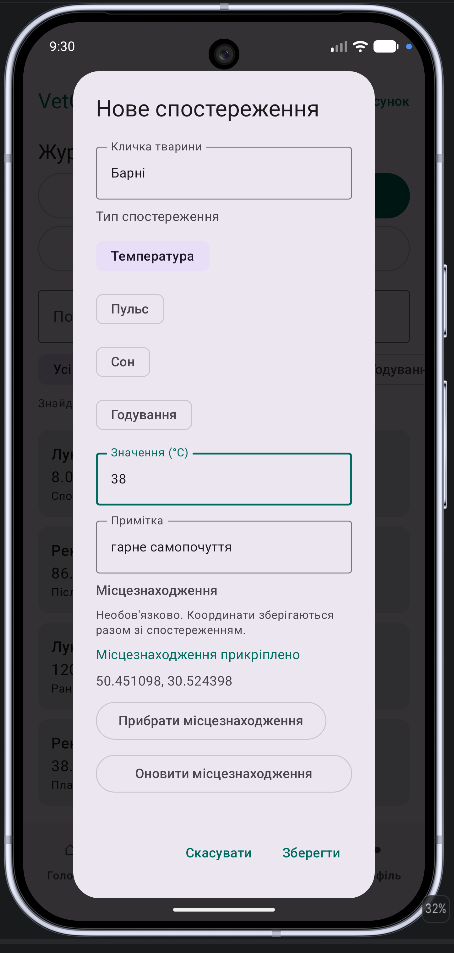

Після збереження координати відображаються в деталях запису (рисунок 18).

**Рисунок 18 — Збережені координати в деталях запису.**

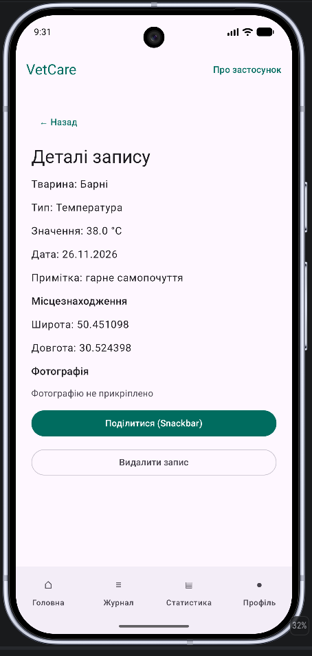

#### 2.5. Інтерактивна карта спостережень

З журналу можна перейти до карти спостережень (рисунок 19).

**Рисунок 19 — Журнал спостережень і кнопка переходу до карти.**

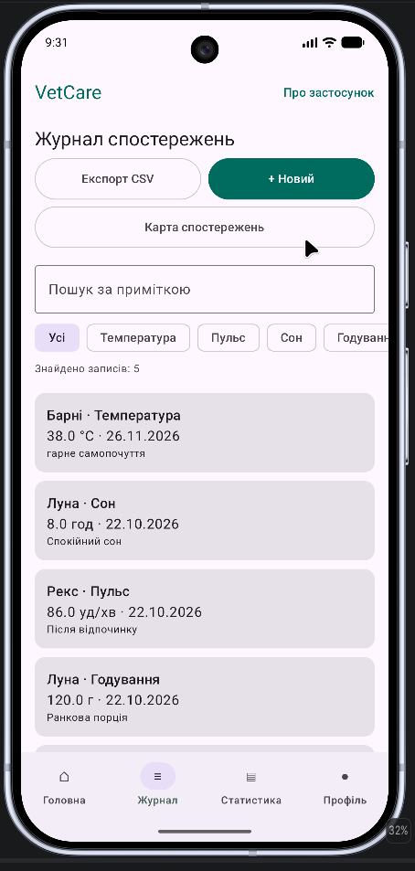

Для карт я використала **MapLibre Android SDK** зі стилем **OpenFreeMap** на основі даних OpenStreetMap. Класичний `MapView` вбудовано в Compose через `AndroidView` і синхронізовано з життєвим циклом екрана: методи `onStart`, `onResume`, `onPause`, `onStop` і `onDestroy` викликаються відповідно до стану Lifecycle, а ресурси карти звільняються при виході. На карті відображаються лише записи з координатами. Вони сортуються хронологічно за датою та ідентифікатором (запис зберігає дату без часу), з'єднуються лінією в порядку створення, а над картою відображаються кількість записів і загальна довжина маршруту. Фільтри **«Сьогодні»** та **«Усі записи»** обмежують набір точок (рисунок 20).

**Рисунок 20 — Карта спостережень із фільтрами «Сьогодні» та «Усі записи».**

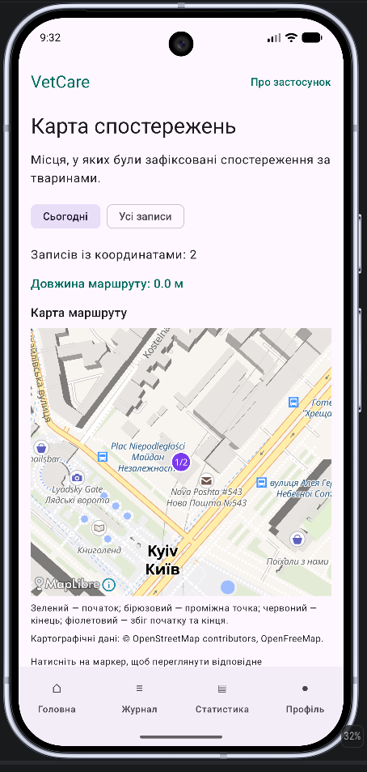

Під картою розміщено список спостережень із GPS-координатами (рисунок 21).

**Рисунок 21 — Список спостережень із GPS-координатами.**

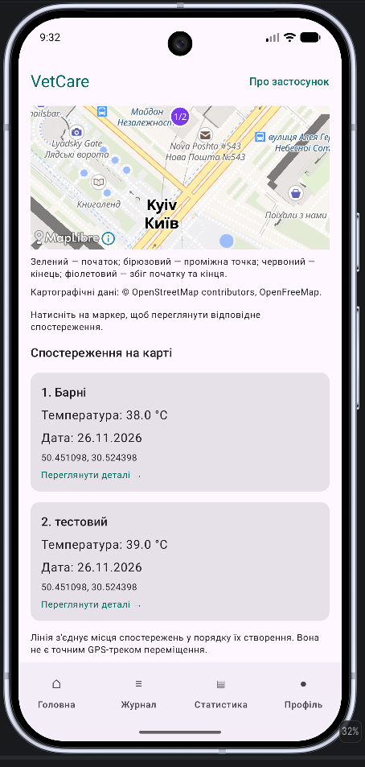

На рисунку 22 показано натискання на маркер карти, а на рисунку 23 — результат цієї дії: діалог зі спостереженнями, прив'язаними до маркера, з можливістю перейти до деталей потрібного запису. Якщо кілька записів мають однакові координати, вони об'єднуються в один маркер і відображаються в цьому діалозі разом. На рисунках 20–23 два спостереження мають **однакові координати**, тому вони позначені спільним маркером **1/2**, а довжина маршруту дорівнює **0 м** — це коректна поведінка, оскільки відстань між однаковими точками нульова. Побудову лінії між різними точками демонструє рисунок 14.

**Рисунок 22 — Взаємодія з маркером на карті.**

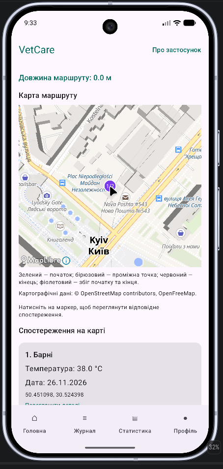

**Рисунок 23 — Діалог зі спостереженнями, що мають однакові координати.**

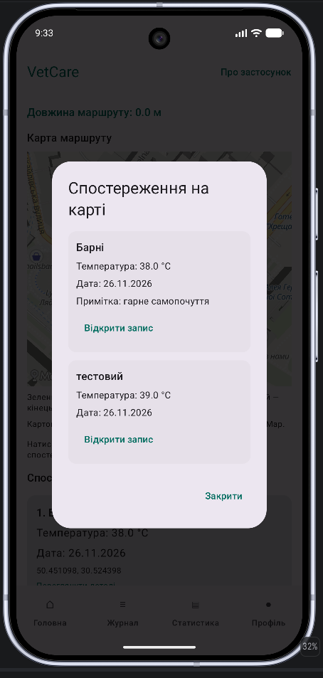

> **Пояснення щодо вибору картографічної бібліотеки.** Під час виконання практичного завдання я розглядала можливість використання Google Maps SDK, проте його налаштування потребувало активації платіжного облікового запису Google Cloud, а доступний мені варіант підключення не відповідав умовам безкоштовної реалізації навчального проєкту. Тому для побудови інтерактивних карт я обрала бібліотеку MapLibre Android SDK із картографічними даними OpenStreetMap та сервісом OpenFreeMap. Це дозволило реалізувати відображення GPS-координат, маркерів, ліній маршруту та його загальної довжини без підключення платіжного облікового запису Google. Додаткове завдання з окремою реалізацією Google Maps і порівнянням бібліотек я не виконувала, однак основний картографічний функціонал реалізовано через альтернативну бібліотеку.

#### 2.6. Камера, галерея та фотографії спостережень

До спостереження можна прикріпити фотографію двома способами (рисунок 24): зробити знімок системною камерою через контракт `ActivityResultContracts.TakePicture()` або вибрати зображення через **Photo Picker** (`ActivityResultContracts.PickVisualMedia()`). Для камери застосунок створює файл у приватному каталозі `observation_photos` і передає камері його `content://`-URI через **FileProvider**. Зображення з Photo Picker копіюється в той самий приватний каталог. У Room зберігається лише відносний шлях `photoPath`, для чого я додала поле `photo_path` міграцією **Room 2 → 3**.

**Рисунок 24 — Форма спостереження з кнопками «Зробити фото» та «Обрати з галереї».**

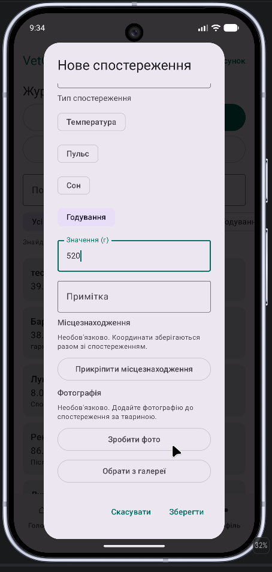

Після вибору зображення у формі відображається мініатюра, а фотографію можна замінити або прибрати. Файли незбереженої чернетки видаляються при заміні фото або скасуванні форми (рисунок 25). На рисунках 25–27 використано **демонстраційне зображення**, а не реальну фотографію тварини.

**Рисунок 25 — Прикріплене демонстраційне зображення та кнопки керування фотографією.**

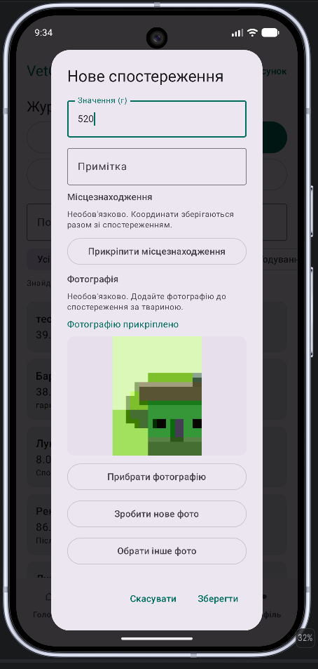

У деталях запису фотографія відображається за допомогою бібліотеки **Coil** (рисунок 26, тварина **Мухтар**, тип «Годування», значення 520 г). Якщо файл відсутній або пошкоджений, замість аварійного завершення показується відповідне повідомлення. Натискання кнопки перегляду відкриває збільшене зображення (рисунок 27).

**Рисунок 26 — Збережена фотографія в деталях спостереження.**

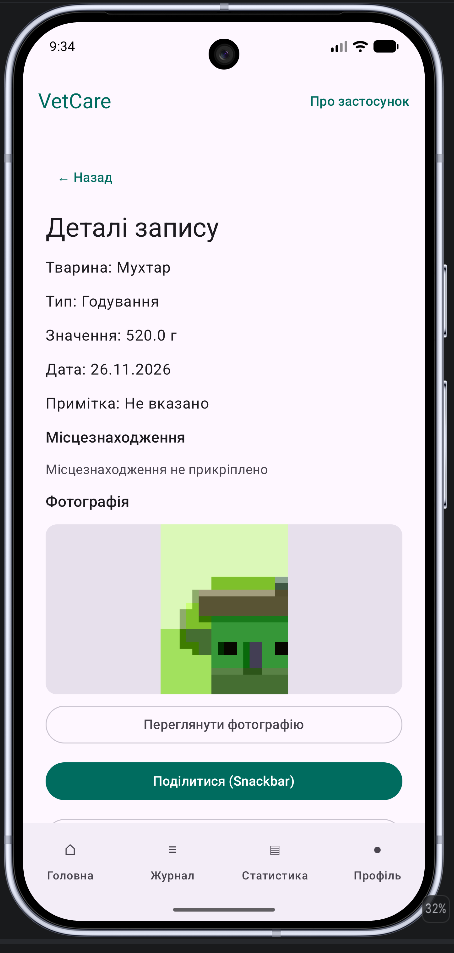

**Рисунок 27 — Збільшений перегляд зображення.**

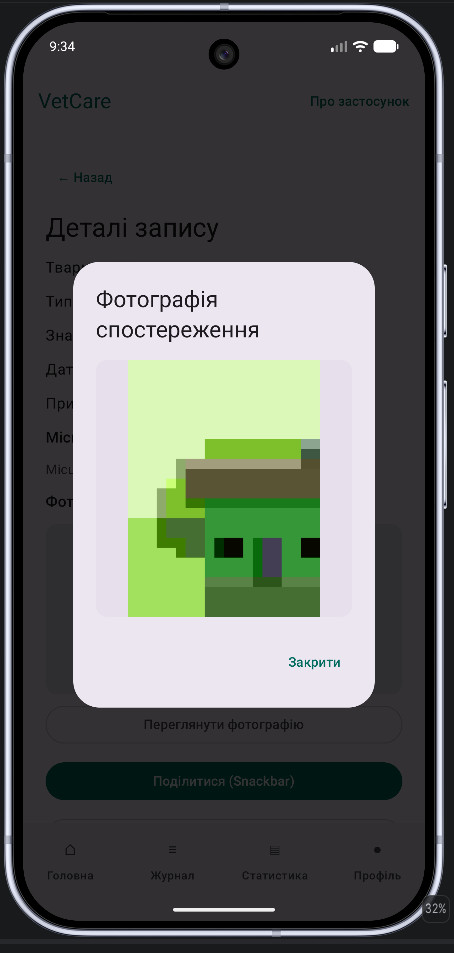

Роботу системної камери та Photo Picker я також перевірила під час комплексного тестування на емуляторі, проте окремих скриншотів цих системних екранів у звіті немає.

#### 2.7. Крокомір та інтеграція із журналом

Для роботи із сенсорами я створила спільний клас `DeviceSensorReader`. Він отримує сенсори через `SensorManager`, перевіряє їхню наявність і дозвіл, реєструє `SensorEventListener` у `callbackFlow` та гарантовано викликає `unregisterListener` після завершення підписки. Крокомір використовує саме **`Sensor.TYPE_STEP_COUNTER`**, а на Android 10+ запитує дозвіл **`ACTIVITY_RECOGNITION`**. На старіших версіях цей runtime-дозвіл не потрібен.

Оскільки `TYPE_STEP_COUNTER` повертає накопичувальну кількість кроків від перезавантаження пристрою, у класі `StepSession` я рахую кроки за сеанс як різницю між поточним і першим (базовим) показником. Вимірювання можна зупинити зі збереженням результату, скинути й розпочати знову. Некоректні значення (від'ємні, `NaN`, нескінченні) ігноруються. Зменшення накопичувального показника (скидання лічильника) не призводить до від'ємного результату. Під час згортання застосунку слухач відключається, а після повернення визначається нова базова точка. `StepCounterViewModel` керує станами екрана: сенсор недоступний, дозвіл не надано або відхилено, очікування першого показника, активне чи зупинене вимірювання. `StepCountRecorder` зберігає результат через `ObservationRepository` як запис нового типу **`ObservationType.STEPS`** («Кроки», одиниця «кроків») з кличкою тварини та приміткою, перевіряє коректність даних і не дозволяє повторно зберегти той самий сеанс. Новий тип інтегровано з фільтрами журналу, статистикою, деталями запису та CSV-експортом, а кількість кроків відображається цілим числом. Кроки, виміряні мобільним пристроєм, є лише навчальним показником і не відповідають точно кількості кроків тварини.

На рисунку 28 показано екран крокоміра на емуляторі: оскільки апаратний сенсор відсутній, застосунок відображає зрозуміле повідомлення замість помилки. На рисунку 29 показано журнал із вибраним фільтром **«Кроки»**; результат порожній, оскільки на емуляторі не було отримано реальних вимірювань.

**Рисунок 28 — Екран крокоміра за відсутності апаратного сенсора.**

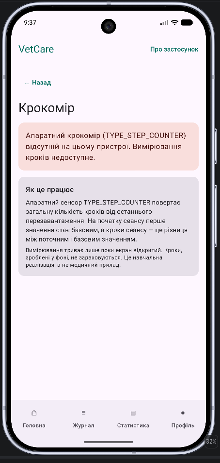

**Рисунок 29 — Журнал із фільтром «Кроки».**

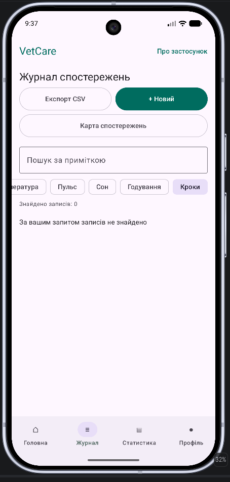

> **Пояснення щодо обмеження тестування крокоміра.** У застосунку реалізовано крокомір на основі апаратного сенсора TYPE_STEP_COUNTER із підтримкою дозволу ACTIVITY_RECOGNITION, підрахунком кроків за сеанс та збереженням результатів у журналі спостережень. Проте використаний емулятор Android не підтримує цей апаратний сенсор, а можливості протестувати функціонал на сумісному фізичному пристрої не було. Тому алгоритм підрахунку та збереження кроків перевірено за допомогою модульних тестів, а на емуляторі продемонстровано коректну обробку відсутності сенсора.

#### 2.8. Бульбашковий рівень

Додатково я реалізувала бульбашковий рівень на основі **`Sensor.TYPE_ACCELEROMETER`**. Акселерометр повертає прискорення за осями X, Y і Z. Показники спочатку згладжуються простим **low-pass filter** (`f = f + 0,15 · (x − f)`), а некоректні значення (`NaN`, вільне падіння, різкі удари) відкидаються. Кути нахилу відносно горизонтальної площини обчислюються в класі `BubbleLevelMath` за формулами `atan2(x, √(y² + z²))` та `atan2(y, √(x² + z²))`, а осі пристрою перераховуються відповідно до поточного повороту екрана. Положення бульбашки пропорційне куту нахилу (край індикатора відповідає 30°) і обмежене межами круглого індикатора. Сам індикатор з осями, центральною контрольною областю та бульбашкою я намалювала за допомогою **Compose Canvas**. Акселерометр працює лише поки екран активний.

Для демонстрації я змінювала віртуальні показники акселерометра засобами Android Emulator і ADB. На рисунку 30 пристрій розташований горизонтально (X = 0°, Y = 0°), і бульбашка перебуває в центрі.

**Рисунок 30 — Горизонтальне положення пристрою.**

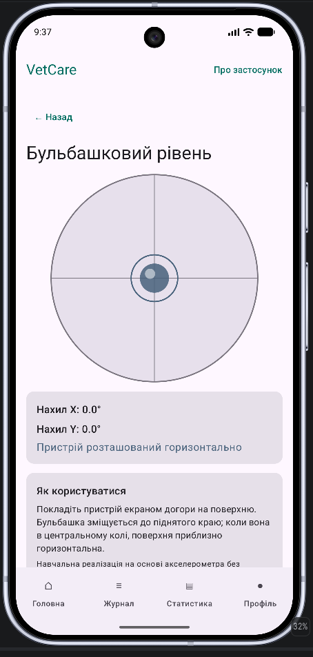

На рисунках 31–33 показано нахил окремо за кожною віссю, а на рисунку 34 — комбінований нахил. Бульбашка зміщується до піднятого краю пристрою.

**Рисунок 31 — Нахил за віссю X: −19,9°.**

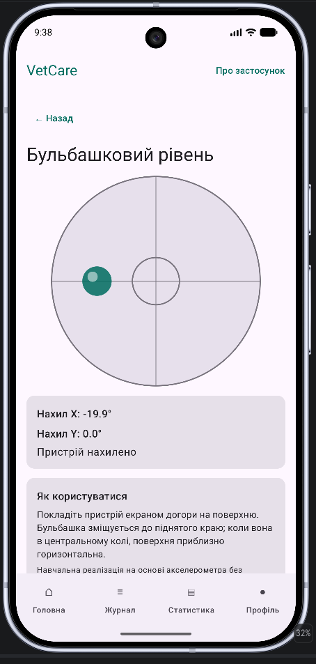

**Рисунок 32 — Нахил за віссю X: 20,0°.**

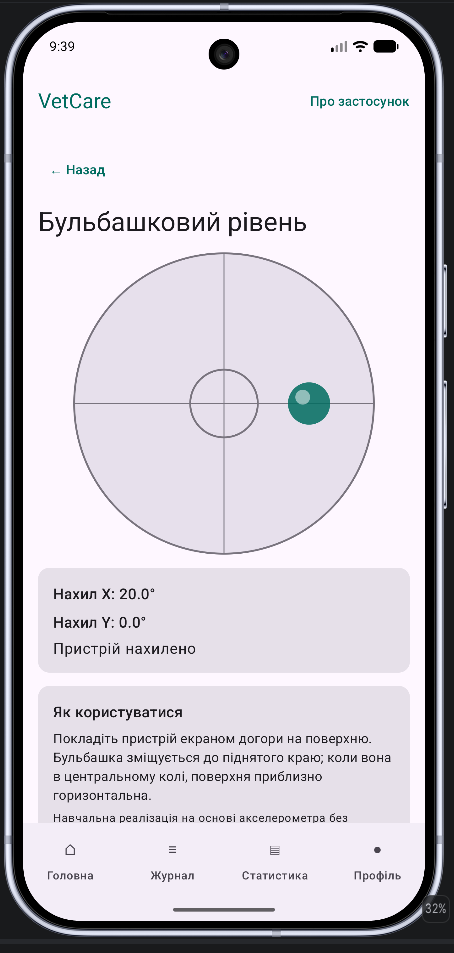

**Рисунок 33 — Нахил за віссю Y: 19,9°.**

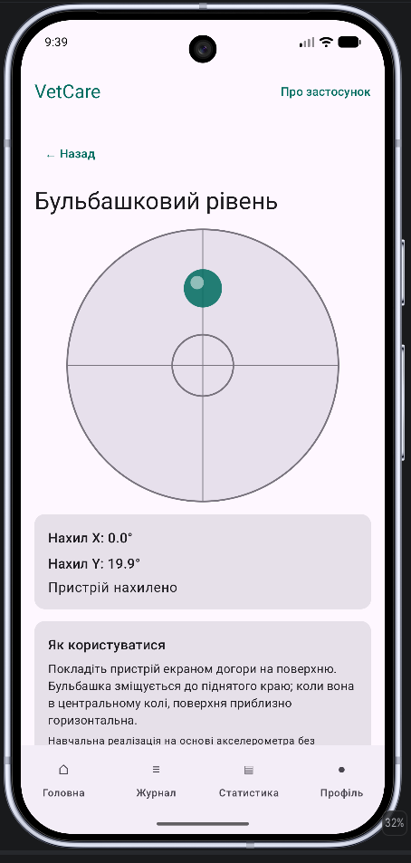

**Рисунок 34 — Комбінований нахил: X = −15°, Y = 10°.**

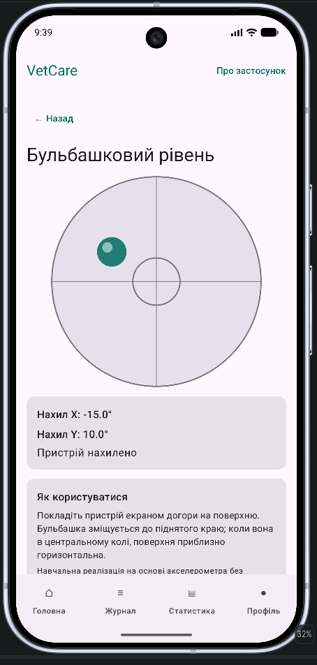

Ця реалізація є навчальною: акселерометр не калібрується, тому рівень не призначений для професійних вимірювань.

#### 2.9. Результати тестування та відомі обмеження

Після завершення реалізації я провела комплексне тестування на емуляторі **Pixel 10 Pro (Android 17, API 37)**. Кількість і результати тестів я перевірила за XML-звітами Gradle:

| Вид тестування | Кількість | Невдалих | Пропущених |
|---|---:|---:|---:|
| Модульні тести | 68 | 0 | 0 |
| Інструментальні тести | 32 | 0 | 0 |
| Усього | 100 | 0 | 0 |

Під час комплексного тестування я додала 7 модульних і 15 інструментальних тестів. Успішно пройдено тести:

- парсингу BLE-даних і збереження пульсу;
- підрахунку та збереження кроків;
- математичної логіки бульбашкового рівня;
- обчислення довжини маршруту;
- файлового сховища фотографій;
- репозиторію спостережень;
- DataStore маршруту дня;
- міграцій Room 1 → 2, 2 → 3 та 1 → 3 (за допомогою `MigrationTestHelper` і збережених JSON-схем);
- операцій із базою даних після міграції: створення, читання, видалення та відновлення записів із координатами, фотографією і типом STEPS.

Поточна версія бази даних Room — **3**.

Під час тестування я виявила та виправила два дефекти:

1. Snackbar із можливістю скасувати видалення запису з'являвся із запізненням, якщо на екрані вже було інше повідомлення. Тепер попереднє повідомлення закривається, а кнопка «Скасувати» відображається одразу.
2. Після надання дозволу на геолокацію потрібно було повторно натискати кнопку прикріплення координат. Тепер координати отримуються автоматично після надання дозволу.

Також я перевірила відновлення записів із GPS-координатами та фотографіями, роботу карти, збереження маршруту після перезапуску, системну камеру, Photo Picker, акселерометр, відключення слухачів сенсорів при виході з екрана та згортанні застосунку, а також регресію функціоналу попередньої роботи (журнал, DataStore, тема, Open-Meteo, кешування, CSV-експорт).

Відомі обмеження:

- відсутність сумісної BLE-периферії для перевірки реального GATT-підключення, рівня заряду та пульсу;
- відсутність `TYPE_STEP_COUNTER` на емуляторі та можливості перевірити крокомір на фізичному пристрої;
- використання MapLibre замість Google Maps;
- сортування спостережень на карті за датою та ID, оскільки запис містить дату без точного часу;
- можливість залишкових файлів фотографій після остаточного видалення запису або примусового завершення процесу. Експериментальний механізм автоматичного очищення я відкликала через потенційний ризик втрати фотографій, тому у фінальній версії його немає.

### 3. Відповіді на контрольні питання розділу 4

**1. Чим BLE відрізняється від Bluetooth Classic?**

Bluetooth Classic призначений для безперервного потокового передавання даних, наприклад звуку, і споживає більше енергії. BLE (Bluetooth Low Energy) розрахований на періодичний обмін невеликими порціями даних із мінімальним енергоспоживанням, тому його використовують датчики, фітнес-браслети та медичні пристрої. Дані в BLE організовано за профілем GATT, а не через постійне з'єднання з потоком байтів.

**2. Назвіть етапи взаємодії з BLE-пристроєм.**

Спочатку потрібно отримати дозволи й перевірити, що Bluetooth увімкнено. Далі виконується сканування, вибір пристрою, GATT-підключення та пошук сервісів (`discoverServices`). Після цього можна читати або записувати характеристики й підписуватися на сповіщення через CCCD. Наприкінці потрібно відключитися й закрити `BluetoothGatt`. У VetCare ці етапи виконують `BleManager` і `BleGattClient`.

**3. Що таке сервіс, характеристика і дескриптор GATT?**

Сервіс — це логічна група пов'язаних даних, наприклад Battery Service `0x180F`. Характеристика — конкретне значення всередині сервісу, яке можна читати, записувати або отримувати через сповіщення, наприклад Battery Level `0x2A19`. Дескриптор містить додаткову інформацію про характеристику або її налаштування, наприклад CCCD `0x2902`.

**4. Навіщо записувати дескриптор CCCD?**

CCCD (Client Characteristic Configuration Descriptor) вмикає на периферійному пристрої надсилання сповіщень (notifications) або індикацій для характеристики. Одного виклику `setCharacteristicNotification()` на Android недостатньо: без запису значення `ENABLE_NOTIFICATION_VALUE` у CCCD пристрій не надсилатиме нові дані. У VetCare так виконується підписка на вимірювання пульсу.

**5. Які дозволи потрібні для BLE на Android 12+?**

На Android 12+ для пошуку пристроїв потрібен `BLUETOOTH_SCAN`, а для підключення та обміну даними — `BLUETOOTH_CONNECT`. Якщо сканування не використовується для визначення місцезнаходження, до `BLUETOOTH_SCAN` додають `android:usesPermissionFlags="neverForLocation"`. Для реклами пристрою використовується `BLUETOOTH_ADVERTISE`. На Android 11 і старіших для сканування потрібен дозвіл на геолокацію.

**6. Чим відрізняються дозволи FINE і COARSE?**

`ACCESS_FINE_LOCATION` дає доступ до точних координат (з точністю до кількох метрів, зокрема через GPS), а `ACCESS_COARSE_LOCATION` — лише до приблизного місцезнаходження (з точністю приблизно до кількох кілометрів або міського кварталу). Починаючи з Android 12, користувач може надати лише приблизну геолокацію навіть тоді, коли застосунок запитує точну.

**7. Як Fused Location Provider поєднує джерела координат?**

Fused Location Provider із Google Play Services поєднує дані GPS, Wi-Fi, мобільних мереж і сенсорів пристрою. Він автоматично обирає оптимальне джерело залежно від заданого пріоритету (точність або енергоефективність), що дає змогу швидше отримувати координати й економити заряд батареї. У VetCare я використала `LocationManager`, який також може звертатися до системного `FUSED_PROVIDER`.

**8. Чим `lastLocation` відрізняється від `getCurrentLocation()`?**

`lastLocation` миттєво повертає останні відомі кешовані координати, які можуть бути застарілими або взагалі відсутніми (`null`). `getCurrentLocation()` призначений для отримання актуального місцезнаходження: він може використати достатньо свіжі кешовані координати або виконати нове визначення, а якщо визначити місцезнаходження не вдалося — повертає `null`. Такий запит може тривати довше й витрачати більше енергії. Для фіксації точок маршруту в VetCare я використала `getCurrentLocation()`.

**9. Чому потрібно відписуватися від оновлень?**

Активні запити геолокації продовжують використовувати GPS і мережу, що швидко розряджає батарею, а також можуть звертатися до вже знищеного екрана та спричиняти витоки пам'яті. Тому оновлення потрібно зупиняти при виході з екрана або в `onPause`/`onStop`. У VetCare незавершений запит координат скасовується через `CancellationSignal`.

**10. Як задати координати на емуляторі?**

Координати можна задати у вікні **Extended Controls → Location** Android Emulator, вказавши точку на карті або завантаживши маршрут GPX/KML. Також можна використати консольну команду `adb emu geo fix <довгота> <широта>`. Саме так я змінювала місцезнаходження під час тестування маршруту.

**11. Що таке плитки карти?**

Плитки (tiles) — це невеликі квадратні фрагменти карти, на які її поділено для кожного рівня масштабу. Застосунок завантажує лише ті плитки, що потрапляють у видиму область, і кешує їх. Плитки бувають растровими (зображення) або векторними (геометрія, яку стилізує клієнт). MapLibre у VetCare використовує векторні плитки OpenFreeMap.

**12. Як вбудувати класичний View у Compose?**

Для цього використовують composable-функцію `AndroidView`: у параметрі `factory` створюється View, а в `update` до нього застосовуються зміни стану Compose. Так у VetCare вбудовано `MapView` бібліотеки MapLibre.

**13. Навіщо синхронізувати карту з життєвим циклом?**

`MapView` використовує OpenGL, мережеві ресурси та кеш, тому йому потрібно передавати події `onStart`, `onResume`, `onPause`, `onStop`, `onDestroy` і `onLowMemory`. Без цього карта може не відображатися, продовжувати роботу у фоні або спричиняти витоки пам'яті. У VetCare ці виклики виконуються через спостерігач Lifecycle, а при виході з екрана ресурси карти звільняються.

**14. Як отримати й захистити API-ключ Google Maps?**

Ключ створюють у Google Cloud Console: потрібно створити проєкт, налаштувати для нього білінг Google Cloud (без цього Maps SDK for Android не працює), увімкнути Maps SDK for Android і згенерувати API key. Для захисту ключ обмежують лише Android-застосунками з певним ім'ям пакета та SHA-1 відбитком сертифіката, а також лише потрібними API. Ключ не варто зберігати у відкритому вигляді в репозиторії: його розміщують у `local.properties` або `secrets.properties` (наприклад, через Secrets Gradle Plugin) і передають у Manifest через `manifestPlaceholders`.

**15. Назвіть причини сірого екрана замість Google-карти.**

Найчастіше це відсутній або неправильний API-ключ, не ввімкнений Maps SDK for Android, невідповідність імені пакета або SHA-1 відбитка налаштованим обмеженням ключа, не налаштований білінг у Google Cloud, відсутність інтернету або Google Play Services на емуляторі, а також відсутність синхронізації `MapView` з життєвим циклом.

**16. Що таке Activity Result API і контракти?**

Activity Result API — це сучасний механізм запуску іншої Activity або системної дії та отримання результату через `registerForActivityResult` (у Compose — `rememberLauncherForActivityResult`) замість застарілого `onActivityResult`. Контракт (`ActivityResultContract`) описує тип вхідних даних і результату. Наприклад, `RequestMultiplePermissions` запитує дозволи, `TakePicture` робить фото, а `PickVisualMedia` відкриває Photo Picker. У VetCare я використала всі три контракти.

**17. Навіщо потрібен FileProvider?**

Починаючи з Android 7, передавати іншим застосункам шляхи `file://` заборонено. `FileProvider` створює безпечний `content://`-URI для файлу з приватного каталогу і дозволяє надати тимчасовий доступ лише до нього. У VetCare він використовується для передавання системній камері файлу для знімка та для поширення CSV-файлу.

**18. Чому для Photo Picker не потрібен дозвіл на галерею?**

Photo Picker працює як системний компонент в окремому процесі: користувач сам вибирає конкретні зображення, а застосунок отримує тимчасовий доступ лише до них. Застосунок не має доступу до всієї медіатеки, тому дозвіл `READ_MEDIA_IMAGES` не потрібен.

**19. Чому фото копіюють у внутрішню пам'ять?**

URI, отриманий від Photo Picker, надає лише тимчасовий доступ, а сам файл користувач може видалити або змінити в галереї. Копіювання у приватний каталог застосунку гарантує, що фотографія залишиться доступною для запису журналу після перезапуску. Крім того, приватні файли недоступні іншим застосункам. У VetCare фото зберігаються в `files/observation_photos`, а в Room записується лише відносний шлях.

**20. Чим CameraX відрізняється від виклику системної камери?**

Виклик системної камери через `TakePicture` передає зйомку стандартному застосунку камери: це просто, не потребує дозволу `CAMERA` в самому застосунку, але не дає контролю над інтерфейсом і параметрами. CameraX — бібліотека Jetpack для вбудовування камери безпосередньо в застосунок: вона дає власний попередній перегляд, налаштування зйомки й аналіз кадрів, але потребує дозволу `CAMERA` та більшого обсягу коду. У VetCare я використала системну камеру.

**21. Які групи сенсорів підтримує Android?**

Android підтримує три основні групи сенсорів:

- сенсори руху: акселерометр, гіроскоп, гравітація, лінійне прискорення, лічильник і детектор кроків;
- сенсори положення: магнітометр, сенсор близькості, вектор обертання;
- сенсори навколишнього середовища: освітленість, тиск, температура, вологість.

Також їх поділяють на апаратні та програмні (обчислені з інших сенсорів).

**22. Що показує акселерометр телефона, який лежить на столі?**

Акселерометр вимірює власне прискорення пристрою, тому навіть у стані спокою його показники враховують вплив гравітації. Якщо телефон нерухомо лежить на столі екраном догори, він показує приблизно X ≈ 0, Y ≈ 0 і Z ≈ +9,81 м/с². Саме такі значення в бульбашковому рівні VetCare відповідають горизонтальному положенню.

**23. Чому потрібно відписуватися від сенсорів?**

Зареєстрований `SensorEventListener` продовжує отримувати події навіть тоді, коли екран неактивний. Це витрачає заряд батареї, навантажує процесор і може спричиняти витоки пам'яті. Тому слухач потрібно знімати через `unregisterListener()` у `onPause` або при виході з екрана. У VetCare слухачі акселерометра та крокоміра відключаються при згортанні застосунку й виході з відповідного екрана.

**24. Як обчислити нахил пристрою?**

Нахил обчислюють за складовими сили тяжіння, яку вимірює акселерометр. Наприклад, кут нахилу за віссю X дорівнює `atan2(x, √(y² + z²))`, а за віссю Y — `atan2(y, √(x² + z²))`, результат переводять із радіанів у градуси. Для стабільності показники попередньо згладжують low-pass filter. Альтернативно можна використати вектор обертання та `SensorManager.getOrientation()`.

**25. Як перевірити сенсори на емуляторі?**

В Android Emulator можна відкрити **Extended Controls → Virtual sensors** і змінювати положення пристрою або значення окремих сенсорів. Також можна використати команду `adb emu sensor set acceleration x:y:z`. Доступні сенсори перевіряються командами `adb shell dumpsys sensorservice` і `adb shell pm list features`. Сенсори, яких на емуляторі немає (як-от `TYPE_STEP_COUNTER` у моєму випадку), потрібно перевіряти на фізичному пристрої, а логіку обробки їхніх даних — модульними тестами.

### 4. Висновок

Під час виконання практичного завдання я навчилася працювати з апаратними можливостями Android-пристрою та інтегрувати їх у журнал спостережень VetCare. Я реалізувала запит runtime-дозволів з урахуванням версії Android і відмови користувача, сканування та GATT-взаємодію з BLE-пристроями, визначення координат і маршруту дня, інтерактивну карту на основі MapLibre, прикріплення фотографій із камери та галереї з безпечним зберіганням у приватному каталозі, а також роботу з крокоміром і акселерометром. Під час роботи я переконалася, наскільки важливо правильно керувати життєвим циклом ресурсів: вчасно зупиняти сканування, скасовувати запити геолокації, звільняти карту та відключати слухачі сенсорів. Не менш важливо коректно обробляти помилки та відсутність обладнання і зберігати дані користувача під час оновлення структури бази даних. Для цього я реалізувала міграції Room і перевірила їх автоматичними тестами. Усього успішно пройдено 100 модульних та інструментальних тестів, а основні сценарії я перевірила на емуляторі. Водночас реальну роботу з BLE-периферією та апаратним крокоміром перевірити не вдалося через відсутність відповідного обладнання, тому ці частини підтверджено лише модульними тестами та перевіркою поведінки за відсутності пристроїв.
