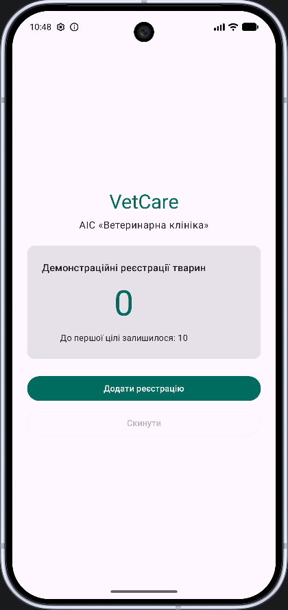
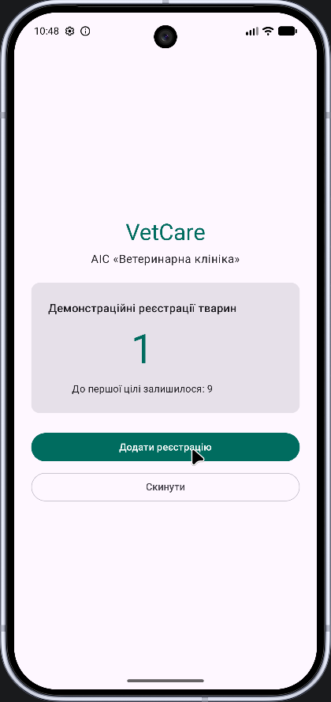
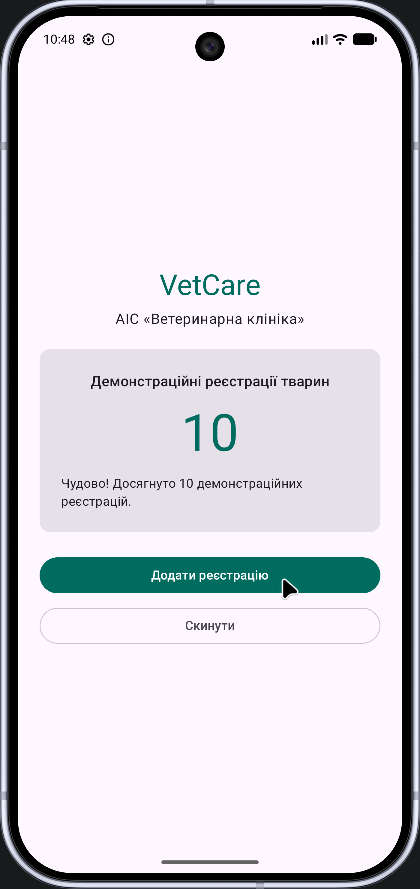
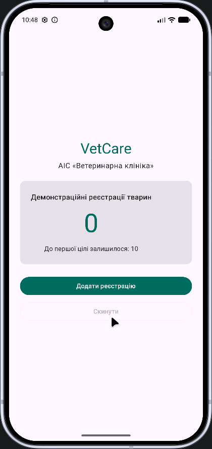
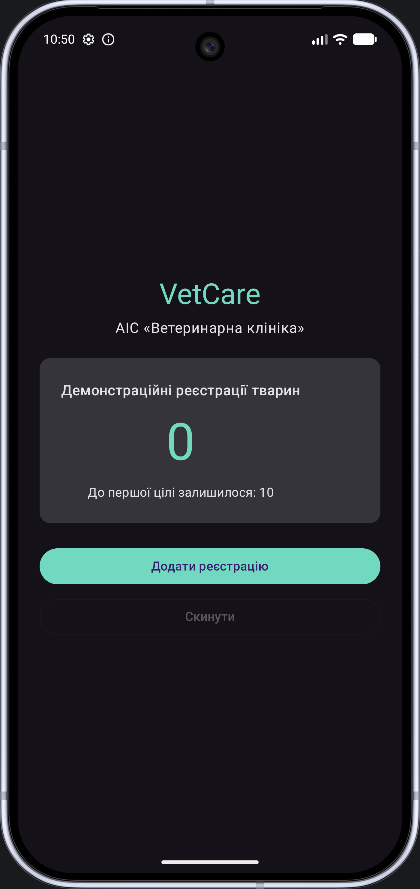

# ЗВІТ З ЛАБОРАТОРНОЇ РОБОТИ № 1
## Середовище розробки і перший застосунок

- **Дисципліна:** Програмування мобільних платформ
- **Індивідуальний проєкт:** VetCare — мобільна АІС «Ветеринарна клініка»
- **Виконала:** Томчак Аліна
- **Перевірив:** Русаловський В.Б.
- **Рік:** 2026

## 1. Мета роботи

Ознайомитися з Android Studio, Android SDK, структурою Android-проєкту, процесом запуску застосунку на емуляторі, базовими компонентами Jetpack Compose та станом інтерфейсу. Навчитися реалізовувати обробку натискань, зміну тексту залежно від стану, кнопку скидання, власну кольорову схему й підтримку темної теми.

## 2. Постановка завдання

Згідно з навчальним посібником «Програмування мобільних платформ. Від першого застосунку до повноцінного проєкту на Kotlin та Jetpack Compose» (розділ 1, підрозділи 1.2–1.3, таблиця 1.9; додаток Е), потрібно:

1. Створити проєкт нативного Android-застосунку з шаблону **Empty Activity** на Kotlin та Jetpack Compose й запустити його в емуляторі.
2. Додати кнопку **«Скинути»**, яка обнуляє лічильник натискань.
3. Забезпечити зміну повідомлення при досягненні **10 натискань**.
4. Для самостійної роботи змінити кольорову тему у `ui/theme/Color.kt`, назву у `res/values/strings.xml` і перевірити застосунок у темному режимі емулятора.

**Адаптація під VetCare.** У початковому застосунку реалізується *навчальний лічильник демонстраційних реєстрацій тварин*: натискання кнопки збільшує кількість, після десяти з'являється повідомлення про досягнення цілі, а кнопка скидання повертає значення до нуля. Реєстрація **не створює реальних медичних карток і не зберігає дані в БД**. Обидві основні ролі майбутньої АІС — власник тварини та ветеринар — будуть додані на наступних етапах.

## 3. Короткі теоретичні відомості

### 3.1. Android, Android Studio та Gradle

Нативний Android-застосунок створюється з використанням інструментів і програмних інтерфейсів Android. **Android Studio** забезпечує редагування коду, синхронізацію залежностей, запуск емулятора й налагодження. **Android SDK** містить програмні інтерфейси й інструменти платформи. **Gradle** керує збиранням: підключає залежності, компілює код і створює результати збірки. **Kotlin DSL** дозволяє описувати конфігурацію Gradle файлами `.gradle.kts`.

Основні частини проєкту:

| Файл або каталог | Призначення |
| --- | --- |
| `settings.gradle.kts` | Назва проєкту, репозиторії та модулі |
| `app/build.gradle.kts` | Параметри Android-модуля і бібліотеки |
| `gradle/libs.versions.toml` | Каталог версій бібліотек та плагінів |
| `app/src/main/AndroidManifest.xml` | Компоненти Android, точка входу, конфігурація застосунку |
| `app/src/main/java/.../MainActivity.kt` | Головна Activity та Compose UI |
| `app/src/main/res/values/strings.xml` | Текстові ресурси, зокрема назва застосунку |
| `app/src/main/java/.../ui/theme/` | Кольори, типографіка та тема Compose |

### 3.2. Activity і Jetpack Compose

`MainActivity` успадковує `ComponentActivity`. У `onCreate()` викликається `setContent { ... }`, яка задає кореневий інтерфейс. **Jetpack Compose** — декларативний спосіб опису екранів за допомогою Kotlin-функцій з анотацією `@Composable`. У роботі використано `Scaffold`, `Column`, `Card`, `Text`, `Button`, `OutlinedButton` та `Spacer`. Об'єкт `Modifier` задає відступи, розміри й інші властивості відображення.

### 3.3. Стан та рекомпозиція

Стан — дані, від яких залежить відображення елементів UI. `remember { mutableIntStateOf(0) }` створює локальне спостережуване цілочисельне значення. Під час його зміни Compose оновлює відповідні частини інтерфейсу: це називається **рекомпозицією**. Значення, збережене через `remember`, не гарантовано переживає перестворення Activity; надалі для цього можна використати `rememberSaveable` або ViewModel.

### 3.4. Material 3 та теми

`MaterialTheme` надає компоненти, схему кольорів і типографіку. Для світлого й темного режимів окремо задаються `lightColorScheme` та `darkColorScheme`; `isSystemInDarkTheme()` допомагає обирати потрібну схему згідно з налаштуваннями Android.

## 4. Середовище реалізації

| Характеристика | Значення |
| --- | --- |
| ОС комп'ютера | Linux Mint |
| IDE | Android Studio |
| Мова | Kotlin |
| UI | Jetpack Compose / Material 3 |
| Шаблон | Empty Activity |
| Назва проєкту | VetCare |
| Package | `com.alisha2112.vetcare` |
| Мінімальний API | 26 (Android 8.0) |
| Збірка | Gradle із Kotlin DSL |
| Перевірка | Android Emulator |
| Репозиторій | [alisha2112/vetcare](https://github.com/alisha2112/vetcare) |

*Конкретну модель віртуального пристрою та версію його системи на скриншотах не зафіксовано; у звіті вони не вигадуються.*

## 5. Хід виконання

### 5.1. Створення проєкту

В Android Studio створено новий проєкт за шаблоном **Empty Activity** з назвою `VetCare`, пакетом `com.alisha2112.vetcare` та мінімальним SDK API 26. Налаштовано GitHub-репозиторій і гілку `feature/lab-01-first-app`. У `settings.gradle.kts` назву кореневого проєкту встановлено `VetCare`.

### 5.2. Головна Activity

Файл: [`MainActivity.kt`](../../app/src/main/java/com/alisha2112/vetcare/MainActivity.kt).

```kotlin
class MainActivity : ComponentActivity() {
    override fun onCreate(savedInstanceState: Bundle?) {
        super.onCreate(savedInstanceState)
        enableEdgeToEdge()
        setContent {
            VetCareTheme {
                Scaffold(modifier = Modifier.fillMaxSize()) { innerPadding ->
                    VetCareCounterScreen(
                        modifier = Modifier
                            .fillMaxSize()
                            .padding(innerPadding)
                    )
                }
            }
        }
    }
}
```

**Пояснення.** `onCreate()` запускає екран, `setContent` встановлює Compose-інтерфейс, `VetCareTheme` застосовує оформлення, `Scaffold` забезпечує каркас, а `innerPadding` допомагає не накладати елементи на системні панелі.

### 5.3. Лічильник і повідомлення

```kotlin
@Composable
fun VetCareCounterScreen(modifier: Modifier = Modifier) {
    var registrations by remember { mutableIntStateOf(0) }

    val status = if (registrations >= 10) {
        "Чудово! Досягнуто 10 демонстраційних реєстрацій."
    } else {
        "До першої цілі залишилося: ${10 - registrations}"
    }

    // Інтерфейс розміщено у Column та Card.
}
```

Поки лічильник менший за 10, виводиться кількість до цілі. На десятому та наступних натисканнях з'являється повідомлення про досягнення цілі. Завдяки стану Compose інформація змінюється без ручного пошуку чи оновлення текстового елемента.

### 5.4. Кнопки керування

```kotlin
Button(
    onClick = { registrations++ },
    modifier = Modifier.fillMaxWidth()
) {
    Text("Додати реєстрацію")
}

OutlinedButton(
    onClick = { registrations = 0 },
    enabled = registrations > 0,
    modifier = Modifier.fillMaxWidth()
) {
    Text("Скинути")
}
```

Кнопка додавання збільшує значення на 1, а кнопка «Скинути» — повертає 0. За нульового значення скидання неактивне завдяки `enabled = registrations > 0`.

### 5.5. Власна палітра й тема

Файл: [`Color.kt`](../../app/src/main/java/com/alisha2112/vetcare/ui/theme/Color.kt).

```kotlin
val VetCareLightPrimary = Color(0xFF006C5F)
val VetCareLightSecondary = Color(0xFF4A635B)
val VetCareLightTertiary = Color(0xFF48627B)

val VetCareDarkPrimary = Color(0xFF72D9C1)
val VetCareDarkSecondary = Color(0xFFB2CCC2)
val VetCareDarkTertiary = Color(0xFFB4C9E7)
```

Ця палітра відповідає зеленувато-бірюзовому оформленню VetCare. Для темного режиму використано світліші акценти, які помітні на темному тлі.

Файл: [`Theme.kt`](../../app/src/main/java/com/alisha2112/vetcare/ui/theme/Theme.kt).

```kotlin
@Composable
fun VetCareTheme(
    darkTheme: Boolean = isSystemInDarkTheme(),
    content: @Composable () -> Unit
) {
    MaterialTheme(
        colorScheme = if (darkTheme) DarkColorScheme else LightColorScheme,
        typography = Typography,
        content = content
    )
}
```

Для цієї роботи використано власні кольори замість динамічних системних, щоб палітра залишалася сталою на різних емуляторах.

### 5.6. Назва застосунку

Файл: [`strings.xml`](../../app/src/main/res/values/strings.xml).

```xml
<resources>
    <string name="app_name">VetCare</string>
</resources>
```

У ресурсах та маніфесті Android також використано назву теми `Theme.VetCare`. Головний екран містить текст «VetCare» та підзаголовок «АІС «Ветеринарна клініка»».

### 5.7. Попередній перегляд

У `MainActivity.kt` реалізовано Compose Preview для світлого й темного режимів. Це дозволяє оцінювати вигляд обох тем у середовищі розробки.

## 6. Перевірка результату

Функціональність перевірено у **Android Emulator**. Підтвердженням слугують п'ять власних знімків екрана, наданих під час виконання роботи. Згідно з домовленістю, в GitHub не завантажуємо зображення окремими PNG; для звіту в Markdown збережено відповідні підписи й результати.

| № | Сценарій перевірки | Очікувано | Отримано |
| --- | --- | --- | --- |
| 1 | Перший запуск | Лічильник `0`, початкова підказка | Виконано |
| 2 | Одне натискання «Додати реєстрацію» | Лічильник `1`, ціль наближається | Виконано |
| 3 | Десять натискань | Лічильник `10`, нове повідомлення | Виконано |
| 4 | Натискання «Скинути» | Лічильник `0`, повернення до початкового тексту | Виконано |
| 5 | Увімкнення темної теми пристрою | Темна кольорова схема й читабельний UI | Виконано |


**Рисунок 1 – Початковий екран VetCare з нульовим значенням лічильника.**



**Рисунок 2 – Відображення першої демонстраційної реєстрації.**



**Рисунок 3 – Досягнення десяти реєстрацій і зміна повідомлення.**



**Рисунок 4 – Стан лічильника після натискання кнопки «Скинути».**



**Рисунок 5 – Інтерфейс VetCare у темній темі Android.**




## 7. Відповіді на контрольні питання (розділ 1.7)

### 1. Чим нативний застосунок відрізняється від кросплатформного?

Нативний застосунок орієнтований на одну платформу та використовує її SDK і нативні UI-бібліотеки; VetCare використовує Kotlin і Jetpack Compose для Android. Кросплатформні підходи дозволяють повторно використовувати значну частину коду між Android та iOS, але деякі функції потребують платформно-залежних інтеграцій.

### 2. Яке призначення Gradle і файлу libs.versions.toml?

Gradle автоматизує збірку, тестування, обробку ресурсів і керування залежностями. `libs.versions.toml` централізовано описує назви та версії бібліотек і плагінів.

### 3. Що описує AndroidManifest.xml?

Маніфест оголошує компоненти застосунку, його головну Activity, налаштування, дозволи й інші відомості, необхідні ОС Android.

### 4. Назвіть методи життєвого циклу Activity.

Основні методи: `onCreate()`, `onStart()`, `onResume()`, `onPause()`, `onStop()`, `onRestart()`, `onDestroy()`.

### 5. Що таке стан у Compose і як він пов'язаний з рекомпозицією?

Стан — дані, що впливають на вигляд інтерфейсу. Коли стан `registrations` змінюється, Compose планує рекомпозицію елементів, які цей стан використовують; так оновлюється число і текст повідомлення.

### 6. Чим val відрізняється від var?

`val` забороняє повторне присвоєння змінній, а `var` дозволяє змінювати її значення. Це не означає, що об'єкт, на який посилається `val`, завжди незмінний.

### 7. Що генерує компілятор для data class?

Для властивостей первинного конструктора `data class` генеруються `equals()`, `hashCode()`, `toString()`, `componentN()` та `copy()`, що спрощує роботу з моделями даних.

### 8. Як працюють оператори ?. і ?:?

`?.` — безпечний виклик, який не звертається до властивості/методу, якщо значення дорівнює `null`. `?:` повертає запасне значення, якщо вираз ліворуч дорівнює `null`. Наприклад: `pet?.name ?: "Без імені"`.

### 9. Чим filter відрізняється від map?

`filter` відбирає елементи колекції, які задовольняють умову. `map` перетворює кожен елемент на нове значення, наприклад формує список імен тварин зі списку об'єктів.

### 10. Коли доречно використовувати enum class?

`enum class` доречний для обмеженого набору іменованих станів, наприклад статусів запису на прийом. Це унеможливлює довільні рядкові значення та покращує контроль типів.

## 8. Висновки

У ході лабораторної №1 створено та запущено перший нативний Android-застосунок VetCare на Kotlin і Jetpack Compose. Реалізовано зміну локального стану за натисканням кнопки, скидання значення лічильника, повідомлення після десяти натискань, власну зеленувато-бірюзову палітру, назву застосунку та відображення у світлій й темній темах. Основні й самостійні завдання відповідають вимогам розділу 1 навчального посібника.

Опрацьовано структуру Android-проєкту, призначення `Activity`, `AndroidManifest.xml`, Gradle, принципи Compose, рекомпозиції та Material 3. Отриманий код є навчальною основою для подальшої розробки повноцінної АІС ветеринарної клініки з ролями власника й ветеринара, локальним сховищем та REST API.

## 9. Використане джерело

Іщенко А. Д., Русаловський В. Б. *Програмування мобільних платформ. Від першого застосунку до повноцінного проєкту на Kotlin та Jetpack Compose*. Одеса, 2026. Розділ 1, таблиця 1.9, додаток Е.
