# ЗВІТ З ЛАБОРАТОРНОЇ РОБОТИ № 2
## Основи Kotlin, інтерфейс, стан і архітектура MVVM у мобільному застосунку VetCare

- **Дисципліна:** Програмування мобільних платформ
- **Індивідуальний проєкт:** VetCare — мобільна АІС «Ветеринарна клініка»
- **Виконала:** Томчак Аліна
- **Перевірив:** Русаловський В. Б.
- **Рік:** 2026

## 1. Мета роботи

Поглибити знання основ мови Kotlin і застосувати їх під час розширення нативного Android-застосунку VetCare. Навчитися створювати багатосторінковий інтерфейс за допомогою Jetpack Compose і Material 3, організовувати переходи між екранами через Navigation Compose, передавати аргументи маршрутів та обробляти дії користувача.

Опанувати роботу зі станом через ViewModel, StateFlow і rememberSaveable; реалізувати фільтрацію, додавання й видалення записів; застосувати архітектуру MVVM із репозиторієм як єдиним джерелом даних та налаштувати впровадження залежностей через Hilt. Перевірити результат запуском на Android-емуляторі й автоматизованими тестами.

## 2. Постановка завдання

У межах лабораторної роботи реалізувати чотири взаємопов’язані блоки:

| Тема | Основне завдання | Самостійна робота |
| --- | --- | --- |
| **Основи Kotlin** | Реалізувати функцію sleepQuality(hours: Double) з умовним виразом when. | Створити модель DaySummary та функцію-розширення summary() для узагальнення записів. |
| **Інтерфейс і навігація** | Додати на екран деталей дію «Поділитися» з повідомленням Snackbar і пункт «Про застосунок» з діалогом. | Створити екран «Статистика» та четверту вкладку нижньої панелі. |
| **Стан застосунку** | Організувати фільтр за типом запису через StateFlow у ViewModel; додати чипи-фільтри. | Після видалення показувати Snackbar з кнопкою «Скасувати» для відновлення запису. |
| **Архітектура** | Додати в репозиторій observeRecordsByType(type) і використовувати цей метод у фільтрації. | Реалізувати впровадження залежностей через Hilt та порівняти його з ручним DI. |

**Адаптація до VetCare.** Предметною областю є демонстраційні спостереження за тваринами: температура, пульс, сон і годування. Кожен запис містить кличку тварини, тип і значення показника, дату та примітку. Система дає можливість переглядати, фільтрувати, додавати, видаляти й відновлювати записи, а також переглядати статистичні підсумки.

На цьому етапі вхід є демонстраційним, без серверної перевірки облікових даних; записи зберігаються лише в оперативній пам’яті. Оцінка тривалості сну є навчальною умовною класифікацією, а не ветеринарною рекомендацією.

## 3. Короткі теоретичні відомості

### 3.1. Основи Kotlin

Kotlin — статично типізована мова з виведенням типів, підтримкою nullable-значень і зручними засобами обробки колекцій. Для незмінного посилання використовується **val**, для змінного — **var**. Вираз **when** дозволяє обирати результат за кількома умовами. **data class** автоматично надає порівняння, текстове подання та копіювання об’єкта, а **enum class** описує фіксований набір допустимих варіантів.

Операції filter, map, sumOf, average, firstOrNull та associateWith дозволяють отримувати підсумкові дані без ручного керування індексами. Оператори ?. та ?: застосовують для безпечної роботи з nullable-значеннями.

### 3.2. Jetpack Compose та Material 3

Jetpack Compose — декларативний підхід до Android-інтерфейсу: composable-функції описують вигляд екрана відповідно до поточного стану. Для побудови VetCare використані Column, Row, Card, LazyColumn, Button, OutlinedTextField, FilterChip, AlertDialog, Snackbar, NavigationBar і TopAppBar.

LazyColumn створює переважно видимі елементи списку; це зручніше й ефективніше для журналу, який згодом може містити багато записів. Компоненти Material 3 використовують спільну тему кольорів і типографіки.

### 3.3. Navigation Compose

Навігацію описує NavHost із типізованими маршрутами. NavController відповідає за переходи й стек попередніх екранів (back stack). Звичайні маршрути можна оголосити як @Serializable data object, а маршрут деталей — як @Serializable data class з ідентифікатором запису. Операції navigate(), popUpTo() і popBackStack() керують переходами та поверненням.

### 3.4. ViewModel, StateFlow і керування станом

ViewModel зберігає логіку стану екрана та переживає перестворення Activity під час зміни конфігурації. MutableStateFlow використовується для внутрішньої зміни значення; StateFlow дозволяє надавати екрану потік лише для читання. collectAsStateWithLifecycle() підписує Compose на ці дані з урахуванням життєвого циклу, після чого зміни спричиняють рекомпозицію.

rememberSaveable підходить для локального стану форми або діалогу. У принципі односпрямованого потоку даних (UDF) стан надходить до інтерфейсу, а події від користувача передаються до ViewModel.

### 3.5. MVVM, репозиторій та Hilt

У MVVM модель представляє дані й правила роботи з ними, View відповідає за відображення, а ViewModel поєднує стан та події користувача. Репозиторій приховує спосіб зберігання записів і виступає єдиним джерелом правди для екранів.

Hilt забезпечує впровадження залежностей: потрібні об’єкти отримуються через конструктори та налаштовані модулі, без ручного створення репозиторію в кожному екрані. Це спрощує підтримку архітектури та дає змогу замінювати реалізацію сховища незалежно від UI.

## 4. Середовище реалізації

| Характеристика | Значення |
| --- | --- |
| Операційна система | Linux Mint |
| Середовище розробки | Android Studio |
| Мова програмування | Kotlin |
| Інтерфейс | Jetpack Compose, Material 3 |
| Навігація | Navigation Compose |
| Керування станом | ViewModel, StateFlow, rememberSaveable |
| Архітектура | MVVM, Repository, Hilt |
| Збірка та тести | Gradle, JUnit, GitHub Actions |
| Емулятор | **Google Pixel 10 Pro** |
| Мінімальний Android API | 26 |
| Ідентифікатор пакета | com.alisha2112.vetcare |
| Робоча гілка | feature/lab-02-kotlin-compose-mvvm |
| Репозиторій | [alisha2112/vetcare-android](https://github.com/alisha2112/vetcare-android) |

## 5. Хід виконання роботи

### 5.1. Розширення структури VetCare

Початковий застосунок із першої лабораторної розширено до прототипу з кількома екранами. Головна Activity тепер відкриває VetCareApp(), яка об’єднує навігацію, екрани та спільні елементи інтерфейсу. Моделі, репозиторій, ViewModel та Hilt-конфігурацію винесено до окремих пакетів.

| Файл | Призначення |
| --- | --- |
| [MainActivity.kt](../../app/src/main/java/com/alisha2112/vetcare/MainActivity.kt) | Точка входу та ініціалізація Compose. |
| [VetCareApp.kt](../../app/src/main/java/com/alisha2112/vetcare/ui/VetCareApp.kt) | Екрани, навігація, форми, діалоги, Snackbar. |
| [VetObservation.kt](../../app/src/main/java/com/alisha2112/vetcare/data/model/VetObservation.kt) | Модель запису, типи, оцінювання сну й статистичні функції. |
| [ObservationRepository.kt](../../app/src/main/java/com/alisha2112/vetcare/data/repository/ObservationRepository.kt) | Інтерфейс доступу до записів. |
| [InMemoryObservationRepository.kt](../../app/src/main/java/com/alisha2112/vetcare/data/repository/InMemoryObservationRepository.kt) | Тимчасове сховище даних у пам’яті. |
| [RecordsViewModel.kt](../../app/src/main/java/com/alisha2112/vetcare/ui/records/RecordsViewModel.kt) | Стан журналу, фільтрація та операції над записами. |
| [ObservationModule.kt](../../app/src/main/java/com/alisha2112/vetcare/di/ObservationModule.kt) | Hilt-зв’язування реалізації з інтерфейсом. |
| [VetObservationTest.kt](../../app/src/test/java/com/alisha2112/vetcare/VetObservationTest.kt) | Модульні тести Kotlin-логіки. |

### 5.2. Моделі даних, enum class та функція sleepQuality()

Типи показників описано через enum class ObservationType. Модель VetObservation містить ID, кличку, тип показника, числове значення, примітку та дату.

~~~kotlin
enum class ObservationType(val title: String, val unit: String) {
    TEMPERATURE("Температура", "°C"),
    PULSE("Пульс", "уд/хв"),
    SLEEP("Сон", "год"),
    FEEDING("Годування", "г")
}

data class VetObservation(
    val id: Long,
    val petName: String,
    val type: ObservationType,
    val value: Double,
    val note: String,
    val recordedAt: String
)
~~~

Для навчальної оцінки сну реалізовано функцію з when. Вона також обробляє від’ємні та нечислові значення.

~~~kotlin
fun sleepQuality(hours: Double): String = when {
    !hours.isFinite() || hours < 0 -> "Некоректне значення"
    hours < 6 -> "Недостатньо"
    hours <= 9 -> "Норма (навчальний приклад)"
    else -> "Забагато (навчальний приклад)"
}
~~~

Для запису Луни зі значенням **8 год** на екрані деталей відображається «Норма (навчальний приклад)». Ця класифікація використовується лише в навчальному прототипі й не є універсальною нормою сну для тварин.

### 5.3. DaySummary і функції-розширення для статистики

Створено data class DaySummary, яка зберігає сумарну кількість корму, середній пульс, тривалість останнього записаного сну й загальну кількість спостережень. Для колекції List<VetObservation> реалізовано функцію-розширення summary().

~~~kotlin
data class DaySummary(
    val totalFeedGrams: Double,
    val averagePulse: Double?,
    val latestSleepHours: Double?,
    val observationCount: Int
)

fun List<VetObservation>.summary(): DaySummary {
    val pulseValues = filter { it.type == ObservationType.PULSE }
        .map { it.value }
    return DaySummary(
        totalFeedGrams = filter { it.type == ObservationType.FEEDING }
            .sumOf { it.value },
        averagePulse = pulseValues.takeIf { it.isNotEmpty() }?.average(),
        latestSleepHours = firstOrNull { it.type == ObservationType.SLEEP }?.value,
        observationCount = size
    )
}
~~~

Окрема функція countByType() підраховує кількість записів для кожного значення enum. Після додавання другого запису пульсу (95 уд/хв) статистика відображає п’ять записів: температуру — 1, пульс — 2, сон — 1, годування — 1. Середній пульс дорівнює 90,5 уд/хв, а в інтерфейсі показано 90 уд/хв через перетворення до цілого числа. Це агреговані демонстраційні дані різних тварин, а не медичні висновки.

### 5.4. Побудова екранів і навігація

Реалізовано демонстраційний вхід із вибором ролі, головний екран, журнал, сторінку статистики, профіль і деталі запису. Чотири основні вкладки розташовані в NavigationBar.

~~~kotlin
@Serializable data object LoginRoute
@Serializable data object HomeRoute
@Serializable data object RecordsRoute
@Serializable data object StatisticsRoute
@Serializable data object ProfileRoute
@Serializable data class DetailsRoute(val recordId: Long)
~~~

При відкритті деталей у маршруті передається ID запису. Для повернення з інших вкладок на «Головна» використано popBackStack<HomeRoute>(inclusive = false). Перемикання вкладок відбувається без некоректного відновлення попередніх маршрутів.

Верхню панель реалізовано через TopAppBar, що враховує системні відступи Android. У профілі є кнопка **«Вийти з профілю»**, яка повертає до форми входу й прибирає авторизовані екрани з історії переходів. Після заповнення форми будь-якими непорожніми тестовими даними відкривається головний екран; реальної автентифікації немає.

### 5.5. Журнал, фільтри та стан у ViewModel

Журнал створено на LazyColumn, а над ним розташовано чипи «Усі», «Температура», «Пульс», «Сон» і «Годування». Вибраний тип зберігається в MutableStateFlow; назовні ViewModel надає StateFlow лише для читання.

~~~kotlin
private val _selectedType = MutableStateFlow<ObservationType?>(null)
val selectedType: StateFlow<ObservationType?> = _selectedType.asStateFlow()

val filteredRecords: StateFlow<List<VetObservation>> =
    selectedType.flatMapLatest { type ->
        if (type == null) repository.observeRecords()
        else repository.observeRecordsByType(type)
    }.stateIn(
        viewModelScope,
        SharingStarted.WhileSubscribed(5_000),
        emptyList()
    )
~~~

Натискання на чип змінює selectedType, після чого формується новий потік відфільтрованих записів. Наприклад, фільтр «Сон» залишає на екрані лише запис Луни. Інтерфейс отримує потоки через collectAsStateWithLifecycle().

### 5.6. Додавання, перевірка полів та деталі запису

За кнопкою «+ Новий» відкривається AlertDialog з полями клички, типу спостереження, числового значення та примітки. Збереження недоступне, якщо кличку не введено або значення не є додатним скінченним числом. Для тестування додано запис **bars**, тип **Пульс**, значення **95 уд/хв**, примітка **test**. Після збереження нова картка з’являється на початку журналу, а статистика оновлюється.

Екран деталей показує кличку тварини, тип, значення, дату й примітку. Для записів сну додатково виводиться навчальна оцінка. Кнопка «Поділитися (Snackbar)» показує короткий текст запису в Snackbar, а не викликає системний діалог поширення. Пункт верхньої панелі «Про застосунок» відкриває AlertDialog з описом VetCare.

### 5.7. Репозиторій, видалення та відновлення

Контракт ObservationRepository описує отримання списку, фільтрацію за типом, додавання, видалення та відновлення запису.

~~~kotlin
interface ObservationRepository {
    fun observeRecords(): Flow<List<VetObservation>>
    fun observeRecordsByType(type: ObservationType): Flow<List<VetObservation>>
    suspend fun addRecord(
        petName: String, type: ObservationType,
        value: Double, note: String
    )
    suspend fun deleteRecord(id: Long): VetObservation?
    suspend fun restoreRecord(record: VetObservation)
}
~~~

У InMemoryObservationRepository дані зберігаються в MutableStateFlow. Метод observeRecordsByType() відбирає записи потрібного типу, а зміни публікуються через оновлення списку. Перед видаленням користувач бачить AlertDialog з підтвердженням. Після видалення Snackbar показує дію «Скасувати», яка викликає restoreRecord(), якщо її натиснути до закриття повідомлення.

~~~kotlin
val result = snackbar.showSnackbar(
    message = "Запис видалено",
    actionLabel = "Скасувати",
    withDismissAction = true,
    duration = SnackbarDuration.Long
)
if (result == SnackbarResult.ActionPerformed) {
    viewModel.restoreRecord(deleted)
}
~~~

### 5.8. Архітектура MVVM та впровадження Hilt

RecordsViewModel залежить від абстракції ObservationRepository. Репозиторій реалізовано в пам’яті, а потрібну реалізацію Hilt передає через модуль зв’язування.

~~~kotlin
@Module
@InstallIn(SingletonComponent::class)
abstract class ObservationModule {
    @Binds
    @Singleton
    abstract fun bindRepository(
        implementation: InMemoryObservationRepository
    ): ObservationRepository
}
~~~

У проєкті VetCareApplication позначено @HiltAndroidApp, MainActivity — @AndroidEntryPoint, RecordsViewModel — @HiltViewModel, а реалізація репозиторію має @Inject-конструктор. Такий спосіб дозволяє не створювати репозиторій вручну всередині Compose-екранів.

| Критерій | Ручне впровадження залежностей | Hilt у VetCare |
| --- | --- | --- |
| Створення репозиторію | Власний контейнер та створення екземпляра. | @Inject-конструктор і модуль @Binds. |
| Передавання до ViewModel | Окрема фабрика з аргументами. | @HiltViewModel і hiltViewModel(). |
| Область існування | Налаштовується вручну. | Визначається компонентами Hilt та @Singleton. |
| Службовий код | Більше явних фабрик і контейнерів. | Менше ручного коду; потрібні плагіни й генерація. |
| Реалізація в цій роботі | Проаналізована для порівняння. | Безпосередньо використана. |

### 5.9. Unit-тести й автоматизована збірка

Створено п’ять unit-тестів для функцій Kotlin: граничні значення sleepQuality(), обчислення підсумків, порожній список, підрахунок за типами та незмінність початкового data class при copy().

~~~kotlin
@Test fun sleepQualityUsesTeachingRanges() {
    assertEquals("Недостатньо", sleepQuality(5.9))
    assertEquals("Норма (навчальний приклад)", sleepQuality(6.0))
    assertEquals("Норма (навчальний приклад)", sleepQuality(9.0))
    assertEquals("Забагато (навчальний приклад)", sleepQuality(9.1))
}
~~~

Для перевірки застосовано Gradle-завдання:

~~~bash
./gradlew :app:assembleDebug :app:testDebugUnitTest
~~~

Автоматичний запуск GitHub Actions для робочої гілки завершився успішно: застосунок зібрано, а unit-тести виконано. Під час розробки також виправлено помилку імпорту типізованого hasRoute(), скориговано верхню панель та навігацію між вкладками.

## 6. Результати запуску й тестування

Застосунок запущено на Android-емуляторі **Google Pixel 10 Pro**. Для перевірки використано демонстраційні записи двох тварин — Луни й Рекса, після чого додано окремий тестовий запис. Нижче наведено результати ручних сценаріїв та скриншоти.

| № | Сценарій | Очікуваний результат | Результат |
| --- | --- | --- | --- |
| 1 | Відкрити екран входу й натиснути «Увійти» з порожніми полями | Підсвічування полів і повідомлення перевірки | Підтверджено, рис. 1–2 |
| 2 | Увійти з тестовими даними | Головна сторінка, чотири записи й дві тварини | Підтверджено, рис. 3 |
| 3 | Додати демонстраційні реєстрації | Лічильник збільшується, стає доступним скидання | Підтверджено для значення 2, рис. 4 |
| 4 | Відкрити журнал і вибрати «Сон» | Показ усіх чотирьох або одного відібраного запису | Підтверджено, рис. 5–6 |
| 5 | Відкрити деталі й натиснути «Поділитися» | Вміст запису й повідомлення Snackbar | Підтверджено, рис. 7–8 |
| 6 | Відкрити порожню та заповнену форму | Блокування некоректного вводу; доступність збереження за валідних значень | Підтверджено, рис. 9–10 |
| 7 | Додати запис пульсу | Новий запис перший у журналі; статистика показує 5 записів | Підтверджено, рис. 11–12 |
| 8 | Видалити запис | Діалог підтвердження та Snackbar з дією «Скасувати» | Підтверджено, рис. 13–14 |
| 9 | Повернути емулятор горизонтально | Елементи UI й нижня навігація залишаються доступними | Підтверджено, рис. 15 |
| 10 | Відкрити «Про застосунок» і профіль | Інформаційний діалог і кнопка виходу | Підтверджено, рис. 16–17 |
| 11 | Автоматична збірка та unit-тести | Успішні assembleDebug і testDebugUnitTest | Успішна GitHub Actions перевірка |

### 6.1. Демонстраційний вхід та перевірка полів

**Рисунок 1 – Початковий екран входу VetCare.**

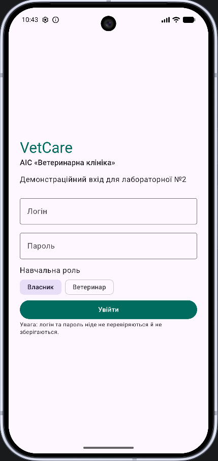

**Рисунок 2 – Валідація порожніх полів логіна та пароля.**

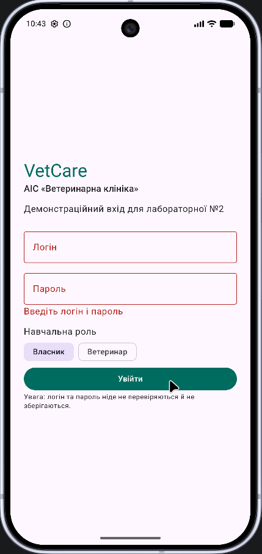

Вхідна форма містить логін, пароль і вибір демонстраційної ролі. За порожніх обов’язкових полів відображається повідомлення «Введіть логін і пароль». Вхід не виконує серверної автентифікації.

### 6.2. Головна сторінка та навчальний лічильник

**Рисунок 3 – Головна сторінка з оглядом клініки та початковими спостереженнями.**

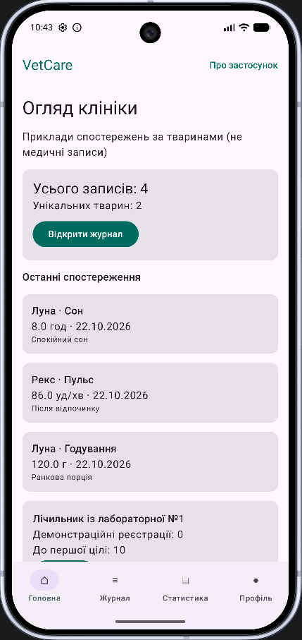

**Рисунок 4 – Лічильник демонстраційних реєстрацій після двох натискань.**

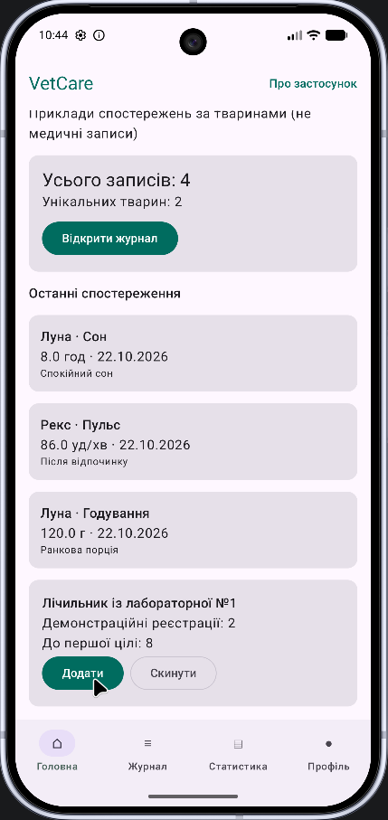

Головна сторінка показує чотири початкові записи для двох тварин та список останніх спостережень. Лічильник із першої лабораторної залишився доступним: після двох натискань його значення дорівнює 2, а до цілі залишається 8.

### 6.3. Журнал спостережень і фільтрація

**Рисунок 5 – Журнал усіх записів.**

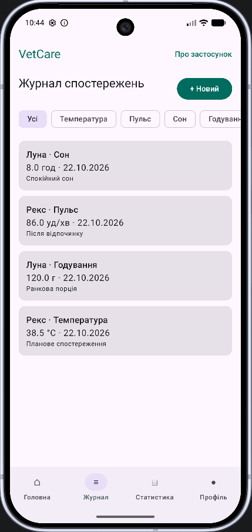

**Рисунок 6 – Фільтр «Сон», що залишає запис Луни.**

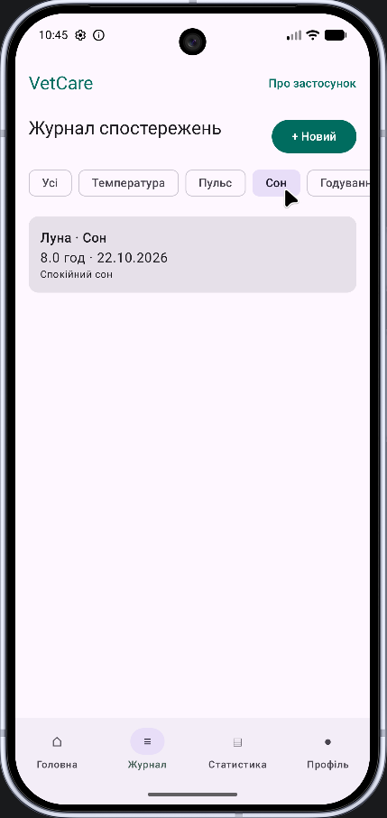

Під час вибору чипа змінюється вміст LazyColumn. На рисунку 6 показано результат фільтрації за типом «Сон» — один запис із значенням 8 год.

### 6.4. Деталі запису та Snackbar

**Рисунок 7 – Деталі запису Луни про сон.**

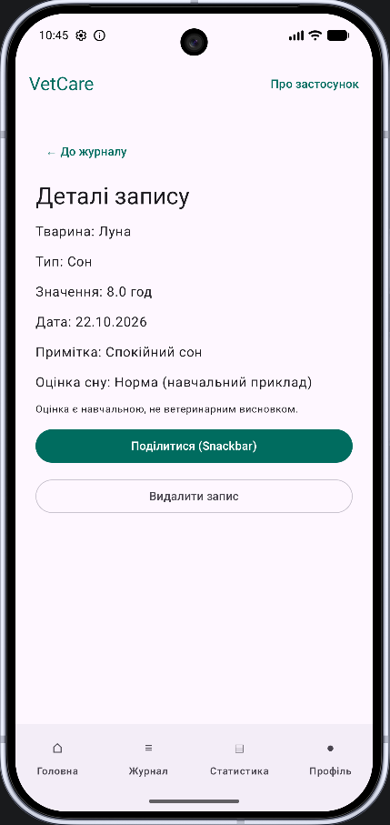

**Рисунок 8 – Повідомлення Snackbar після натискання «Поділитися».**

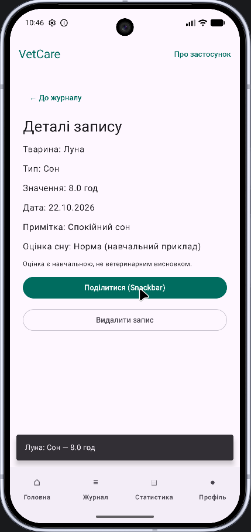

Екран деталей показує кличку, тип, показник, дату й примітку. Для сну відображається навчальна класифікація. Дія «Поділитися» формує Snackbar з коротким вмістом запису.

### 6.5. Форма додавання та валідація

**Рисунок 9 – Порожня форма з неактивною кнопкою «Зберегти».**

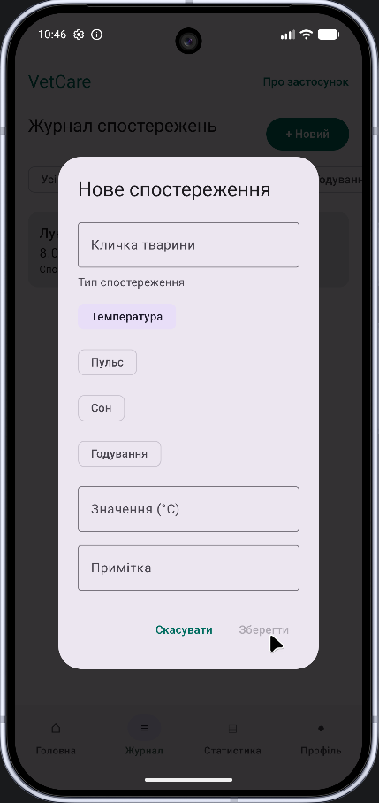

**Рисунок 10 – Заповнена форма з тестовим значенням пульсу.**

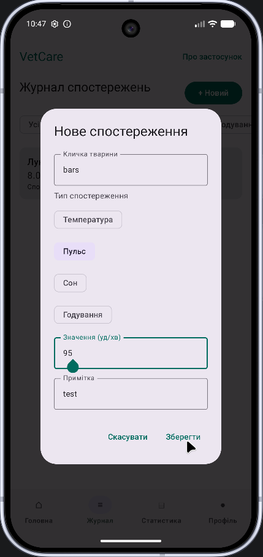

Форма перевіряє кличку й числовий показник. У прикладі заповнено кличку bars, тип «Пульс», значення 95 і примітку test; після цього кнопка «Зберегти» стала доступною.

### 6.6. Оновлення журналу та статистики

**Рисунок 11 – Поява нового запису bars у журналі.**

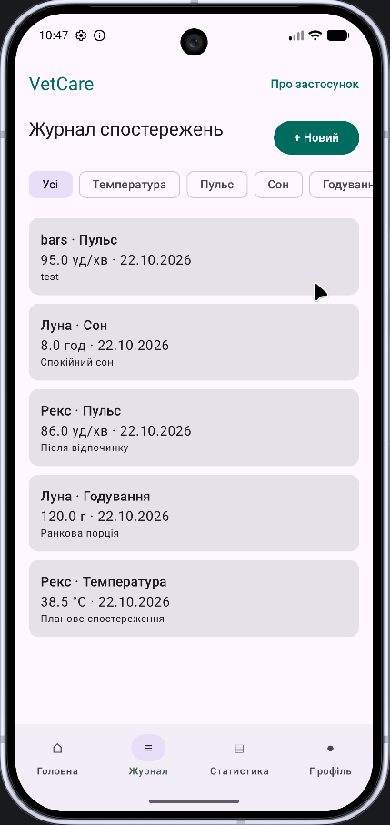

**Рисунок 12 – Статистика після додавання п’ятого запису.**

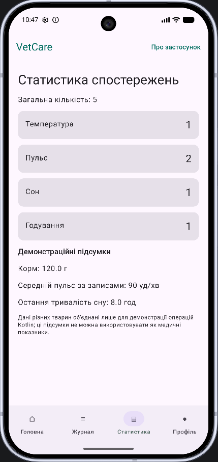

Після додавання дані оновилися: загальна кількість — 5, записи пульсу — 2; інші типи мають по одному запису. Середній пульс із двох записів — 90,5 уд/хв, що на екрані відображається цілим числом 90.

### 6.7. Видалення запису та дія «Скасувати»

**Рисунок 13 – Діалог підтвердження видалення спостереження.**

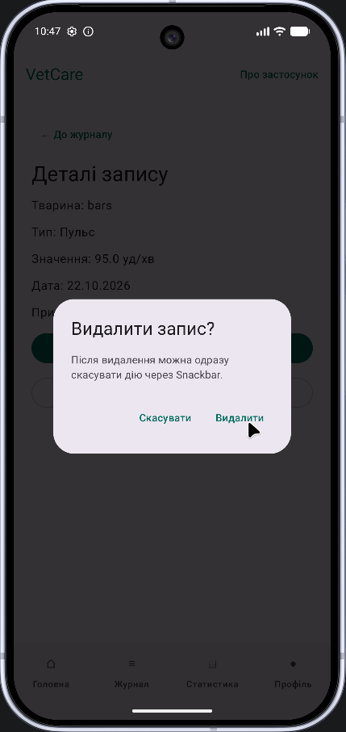

**Рисунок 14 – Snackbar із дією «Скасувати» після видалення запису.**

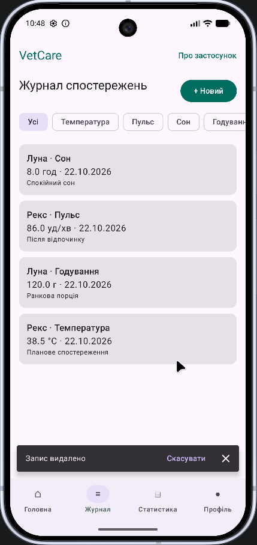

Після підтвердження тестовий запис видалено, а журнал знову містить чотири початкові спостереження. У Snackbar доступна дія «Скасувати» для повернення запису; окремого скриншота стану після її натискання немає.

### 6.8. Горизонтальна орієнтація

**Рисунок 15 – Головна сторінка VetCare після повороту Pixel 10 Pro.**

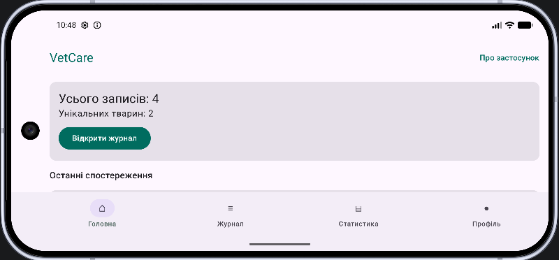

У горизонтальній орієнтації верхня панель, картки та нижня навігація залишилися доступними. Сторінку можна прокручувати для перегляду вмісту, що не поміщається у видимій частині екрана.

### 6.9. Про застосунок та профіль

**Рисунок 16 – Діалог «Про VetCare».**

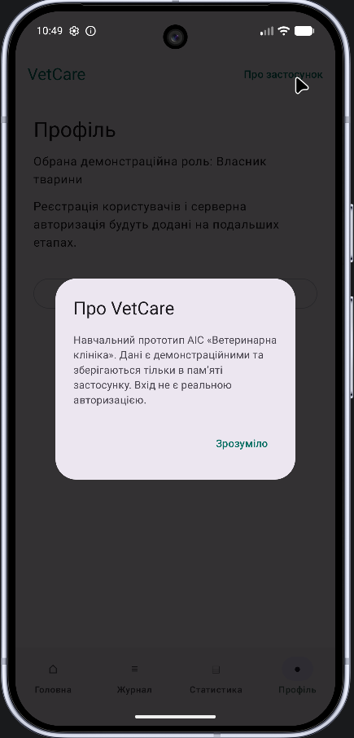

**Рисунок 17 – Екран профілю з кнопкою «Вийти з профілю».**

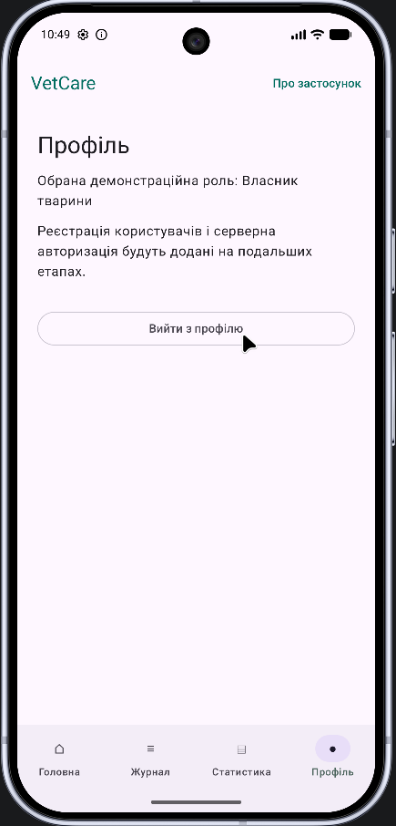

Діалог містить короткий опис призначення застосунку й повідомляє про демонстраційні дані. У профілі показано вибрану роль і кнопку виходу, що повертає користувача на форму входу.

## 7. Відповіді на контрольні питання

### 7.1. Питання з основ Kotlin та Android (розділ 1)

**1. Чим нативний застосунок відрізняється від кросплатформного?**

Нативний застосунок створюють для конкретної операційної системи з використанням її SDK та рекомендованих інструментів. Кросплатформний використовує спільний код для кількох платформ і за необхідності звертається до їхніх API. VetCare є нативним Android-застосунком на Kotlin.

**2. Яке призначення Gradle і файлу libs.versions.toml?**

Gradle збирає проєкт, запускає тести й керує залежностями. У libs.versions.toml централізовано задаються версії бібліотек і плагінів, які підключаються через псевдоніми у build.gradle.kts.

**3. Що описує AndroidManifest.xml?**

У маніфесті оголошують компоненти Android-застосунку, зокрема Application і Activity, а також параметри запуску, налаштування й дозволи. У VetCare зареєстровано VetCareApplication та MainActivity.

**4. Назвіть методи життєвого циклу Activity.**

Основні методи: onCreate(), onStart(), onResume(), onPause(), onStop(), onRestart(), onDestroy(). Вони описують послідовні стани створення, відображення, активної роботи та завершення Activity.

**5. Що таке стан у Compose і як він пов’язаний із рекомпозицією?**

Стан — це дані, які впливають на вигляд інтерфейсу. Коли змінюється спостережуване значення, Compose оновлює залежні composable-функції через рекомпозицію. Прикладом є зміна списку записів після додавання нового спостереження.

**6. Чим val відрізняється від var?**

val не допускає повторного присвоєння посиланню, а var дозволяє змінити його значення. У моделях VetObservation більшість властивостей оголошено як val; стан елементів форми може бути var.

**7. Що генерує компілятор для data class?**

Для властивостей первинного конструктора він генерує equals(), hashCode(), toString(), componentN() та copy(). Наприклад, copy() дає змогу створити змінену копію VetObservation, не змінюючи початковий об’єкт.

**8. Як працюють оператори ?. і ?:?**

Оператор ?. безпечно звертається до nullable-значення лише тоді, коли воно не null. Оператор ?: задає значення за замовчуванням. У статистиці відсутній середній пульс відображається прочерком.

**9. Чим filter відрізняється від map?**

filter відбирає елементи за умовою, а map перетворює кожен елемент. У summary() спочатку filter залишає записи пульсу, потім map бере числові значення для average().

**10. Коли доречно використовувати enum class?**

Коли набір варіантів обмежений і відомий наперед. У VetCare enum class ObservationType визначає типи спостережень, що виключає довільні неприпустимі рядки.

### 7.2. Питання з інтерфейсу, стану та архітектури (розділ 2)

**11. Чим декларативний UI відрізняється від імперативного?**

У декларативному підході розробник описує інтерфейс як функцію поточного стану, а фреймворк сам оновлює елементи після змін. В імперативному підході код явно змінює конкретні властивості елементів UI.

**12. Для чого потрібні модифікатори і чи важливий їх порядок?**

Modifier задає розміри, відступи, колір, клікабельність та іншу поведінку компонента. Порядок важливий: padding перед background і background перед padding можуть зафарбовувати різні області.

**13. Чому для довгих списків використовують LazyColumn?**

LazyColumn створює й компонувує головно видимі елементи, що зменшує навантаження на пам’ять і час побудови інтерфейсу. У VetCare це використано для журналу спостережень.

**14. Як передати аргумент між екранами в Navigation Compose?**

Аргумент можна оголосити в типізованому маршруті, наприклад DetailsRoute(recordId: Long), передати через navigate(DetailsRoute(id)) та прочитати на цільовому екрані через toRoute<DetailsRoute>().

**15. Що робить popUpTo?**

popUpTo прибирає з back stack маршрути до вказаного пункту, за потреби включно з ним. Це дає змогу не залишати зайві екрани в історії. У VetCare під час виходу прибираються екрани авторизованої частини.

**16. Чим remember відрізняється від rememberSaveable?**

remember утримує локальний стан під час рекомпозиції, але зазвичай втрачає його після перестворення Activity. rememberSaveable зберігає придатні до серіалізації значення через механізм SavedState, тож їх можна відновити після повороту.

**17. Чому ViewModel переживає поворот екрана?**

ViewModel прив’язана до ViewModelStoreOwner, який зберігає свій ViewModelStore під час конфігураційного перестворення Activity. Тому стан ViewModel не потрібно відтворювати щоразу під час зміни орієнтації.

**18. Що таке підйом стану?**

State hoisting — перенесення власника стану на вищий рівень композиції. Дочірній компонент отримує поточне значення і колбек, а не змінює спільні дані напряму.

**19. Навіщо розділяти MutableStateFlow і StateFlow?**

MutableStateFlow дозволяє змінювати значення; StateFlow надає інтерфейс спостереження без зовнішнього редагування. ViewModel таким чином контролює, які події можуть оновлювати дані.

**20. Чому стан має бути незмінним?**

Незмінні об’єкти полегшують відстеження змін і запобігають непомітним мутаціям колекцій. InMemoryObservationRepository оновлює потік новими списками, наприклад через filterNot після видалення.

**21. Які шари виділяють в архітектурі Android-застосунку?**

Мінімально розрізняють UI-шар (екрани, ViewModel) і шар даних (репозиторії, джерела даних); за потреби між ними додають окремий доменний шар. У VetCare застосовано UI і Data.

**22. Навіщо ViewModel залежить від інтерфейсу репозиторію, а не від класу?**

Залежність від абстракції дає можливість підміняти реалізації без зміни ViewModel. Зараз використовується InMemoryObservationRepository, а надалі можна додати збереження в Room або обмін із REST API.

**23. Що таке єдине джерело правди?**

Це компонент, який володіє актуальною версією певних даних. У VetCare репозиторій зберігає список спостережень, а різні екрани відображають його через ViewModel, що мінімізує розходження.

**24. Для чого потрібна фабрика ViewModel?**

Фабрика створює ViewModel з потрібними аргументами й залежностями. За ручного DI її пишуть самостійно; у VetCare створення ViewModel з репозиторієм виконує Hilt через @HiltViewModel і hiltViewModel().

**25. Що робить stateIn з WhileSubscribed?**

stateIn перетворює Flow на StateFlow в заданій CoroutineScope. WhileSubscribed(5_000) зберігає підписку, коли є спостерігачі, та призупиняє її з затримкою після їхнього зникнення, що зменшує непотрібну роботу потоку.

## 8. Висновки

Під час виконання лабораторної роботи №2 було суттєво розширено початковий застосунок VetCare та перетворено його з одного навчального екрана на багатосторінковий прототип автоматизованої інформаційної системи «Ветеринарна клініка». Робота дала змогу закріпити знання мови Kotlin та побачити, як окремі мовні засоби використовуються під час побудови реального інтерфейсу. Зокрема, створено моделі даних за допомогою data class і enum class, реалізовано функцію sleepQuality() із розгалуженням when, опрацьовано nullable-значення та застосовано операції filter, map, sumOf, average, firstOrNull і associateWith для формування статистичних підсумків. Я навчилася не лише записувати подібні операції синтаксично правильно, а й пов’язувати їх із потребами конкретної предметної області та передбачати поведінку для порожніх або некоректних значень.

Особливо корисною стала практика побудови інтерфейсу на Jetpack Compose. У ході роботи я навчилася компонувати екрани з Card, Column, LazyColumn, AlertDialog, Snackbar і TopAppBar, реалізовувати валідацію полів, інтерактивні фільтри та нижню панель навігації. Також я краще зрозуміла, як організовується перехід між окремими екранами, як передати ідентифікатор обраного запису та як працює стек навігації. Під час ручного тестування було виявлено практичні недоліки: перекривання системного рядка стану елементами верхньої панелі, відсутність виходу з демонстраційного профілю та некоректне повернення до головної вкладки. Аналіз і виправлення цих ситуацій допомогли усвідомити важливість системних відступів, коректного керування back stack та послідовної перевірки користувацьких сценаріїв.

Ще одним важливим результатом стало практичне знайомство з архітектурою MVVM. Я розібралася, чому дані та операції над ними не слід розміщувати безпосередньо в composable-функціях, як ViewModel надає екрану стан через StateFlow та як односпрямований потік подій допомагає забезпечувати узгодженість інтерфейсу. На прикладі журналу стало зрозуміло, що фільтрація, додавання й видалення записів можуть змінювати єдине джерело даних, після чого всі підписані екрани отримують оновлені значення. Також було вивчено призначення rememberSaveable і роль ViewModel у збереженні стану при перестворенні Activity, зокрема під час повороту емулятора.

Вивчення репозиторію та Hilt допомогло зрозуміти, для чого у проєкті потрібні інтерфейси й впровадження залежностей. Я побачила різницю між безпосереднім створенням репозиторію в коді екрана та отриманням готової реалізації через DI-контейнер. Завдяки цьому поточний варіант VetCare можна в майбутньому розвинути, замінивши тимчасове сховище на локальну базу даних і серверні запити, не переписуючи всі екрани. Окремо було опрацьовано перевірку Kotlin-логіки через unit-тести та автоматичну збірку GitHub Actions, що формує навички не лише написання коду, а й контролю його якості.

Результати лабораторної підтверджено запуском на емуляторі Google Pixel 10 Pro, демонстрацією основних екранів, фільтрації, додавання, статистики, видалення з можливістю скасування та роботи інтерфейсу в горизонтальній орієнтації. При цьому важливо, що VetCare поки залишається навчальним прототипом: демонстраційний вхід не виконує справжньої авторизації, записи зберігаються лише в оперативній пам’яті, а статистичні розрахунки не є ветеринарним висновком. Отже, мети лабораторної роботи досягнуто: отримано практичний досвід Kotlin, Compose, Navigation, MVVM, StateFlow і Hilt, а також створено архітектурну основу для подальшої реалізації повноцінної АІС ветеринарної клініки.

## 9. Використані джерела та посилання

1. Іщенко А. Д., Русаловський В. Б. *Програмування мобільних платформ. Від першого застосунку до повноцінного проєкту на Kotlin та Jetpack Compose*. Одеса: ДУІТЗ, 2026. Розділи 1–2.
2. [Репозиторій VetCare Android](https://github.com/alisha2112/vetcare).
